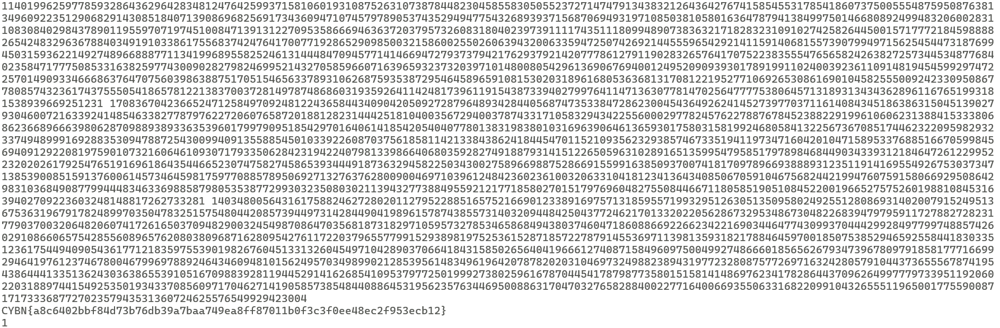

# Challenge Overview

This challenge provides a Sage script:

```python
from itertools import count
from hashlib import sha256

for x in count(start=1):
    for y in range(1,x+1):
        for z in range(1,x+1):
            if x**3+y**3==538*z**3:
                h=sha256(str(z).encode()).hexdigest()
                print(f'CYBN{{{h}}}')
                exit(1)
```

The goal is to find the smallest triplet $(x, y, z) \in \mathbb{N}^3$:

$$
x^3 + y^3 = 538 z^3
$$

# Solution

We divide both sides by $z^3$ to get:

$$
\left(\frac{x}{z}\right)^3 + \left(\frac{y}{z}\right)^3 = 538
$$

This means we are looking for a rational solution $(X, Y) = (x/z, y/z)$ to:

$$
X^3 + Y^3 = n
$$

According to [Math StackExchange](https://math.stackexchange.com/questions/4217163/find-all-n-in-mathbbq-such-that-x3-y3-n-has-at-least-one-and-only), this equation can be mapped to an elliptic curve:

$$
E_n: \quad y^2 = x^3 - 432 n^2
$$

Rational points $P$ on $E_n$ can be transformed into integer solutions of the original equation via the **Selmer-type parametrization**:

```python
def get_selmer_point(n, P):
    """Here P = (x, y) is a point on y² = x³ − 432 n²"""
    x, y = P.xy()
    X = (36*n - y) / (6 * x)
    Y = (36*n + y) / (6 * x)
    denom = gcd(X.denominator(), Y.denominator())
    return (X*denom, Y*denom, denom)
```

This function returns the smallest triplet $(x, y, z) \in \mathbb{Z}^3$:

$$
x^3 + y^3 = n z^3
$$

This is almost enough to solve the challenge (for $n = 538$), but because the triplet is in $\mathbb{Z}^3$ and not $\mathbb{N}^3$, some values may be negative.

```python
E = EllipticCurve([0, -432*(538**2)])
G = E.gen(0)
get_selmer_point(538, G)
# (5105211036271631, -5088808335915919, 133442818913404)

```
We can find the second smallest solution by using **2G**, and keep increasing the multiple of **G** until we find a solution in $\mathbb{N}^3$.

```python
from hashlib import sha256

def get_selmer_point(n, P):
    x, y = P.xy()
    X, Y = (36*n - y)/6/x, (36*n + y)/6/x
    denom = gcd(X.denominator(), Y.denominator())
    return (X*denom, Y*denom, denom)

E = EllipticCurve([0, -432*(538**2)])
G = E.gen(0)
for i in range(1, 100):
  x,y,z = get_selmer_point(538, G*i)
  if x**3 + y**3 == 538*z**3:
    if x > 0 and y > 0 and z > 0:
      print(x,y,z)
      h = sha256(str(z).encode()).hexdigest()
      print(f"CYBN{{{h}}}")
      exit(1)
```


