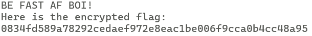
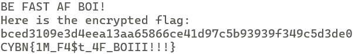

# Challenge Overview
We are given a Python script that encrypts data using XOR with a key derived from the current Unix timestamp. 
The key is generated by hashing the current timestamp with SHA-256 and then XORing it against the plaintext.

```python
#!/usr/bin/env python3
import time, hashlib
from Crypto.Util.number import long_to_bytes

def gen_key():
    current_time = int(time.time())
    key = long_to_bytes(current_time)
    return hashlib.sha256(key).digest()

def encrypt(b):
    key = gen_key()
    ciphertext = b''
    for i in range(len(b)):
        ciphertext += bytes([b[i] ^ key[i % len(key)]])
    return ciphertext.hex()
```

When we connect to the remote instance, we receive the encrypted flag.



# Solution

We simply need to connect to the remote instance, retrieve the encrypted flag, the current timestamp hashed with SHA-256, and then XOR them with each other to retrieve the flag.

```python
import socket, time, hashlib
from Crypto.Util.number import long_to_bytes

HOST, PORT = "localhost", 2222

def recv_line(s):
    b = b""
    while not b.endswith(b"\n"):
        c = s.recv(1)
        if not c: raise EOFError
        b += c
    return b

with socket.create_connection((HOST, PORT)) as s:
    print(recv_line(s).decode(), end="")
    print(recv_line(s).decode(), end="")
    ct_hex = recv_line(s).decode().strip()
    print(ct_hex)

ct = bytes.fromhex(ct_hex)
ts = int(time.time())
k = hashlib.sha256(long_to_bytes(ts)).digest()
pt = bytes(c ^ k[i % len(k)] for i, c in enumerate(ct))
print(pt.decode())
```

