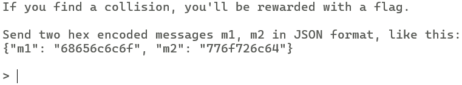
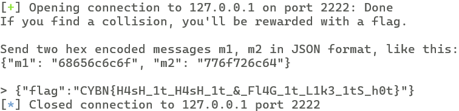

# Challenge Overview
We are given a Python script that implements a custom hashing function. Before processing, the message is padded using a custom padding routine. However, the padding logic contains a critical flaw that makes the hashing function vulnerable to collisions.

```python
def pad(data):
    padding_len = (BLOCK_SIZE - len(data)) % BLOCK_SIZE
    return data + bytes([padding_len]*padding_len)
```

This means that if the input length is already a multiple of 32 bytes, **no padding is added**.  

When we connect to the remote instance, we are greeted with the following instructions:



# Solution

We simply need to provide two distinct inputs that collide during hashing.

We exploit the padding bug by submitting two messages:

- `m1`: 31 bytes → gets padded with a single `0x01`
- `m2`: 32 bytes → no padding added due to the flawed padding calculation

```python
#!/usr/bin/env python3
from pwn import remote; import json

HOST,PORT="127.0.0.1",2222

m1= b"A"*31
m2 = m1+b"\x01"

line=(json.dumps({"m1":m1.hex(),"m2":m2.hex()},separators=(",",":"))+"\n").encode()

with remote(HOST, PORT, timeout=5) as r:
    p= r.recv(timeout=1)
    print(p.decode(errors="replace"), end="") if p else None
    r.send(line)
    resp = r.recvline(timeout=5)
    print(resp.decode(errors="replace").rstrip("\n")) if resp else None
```

