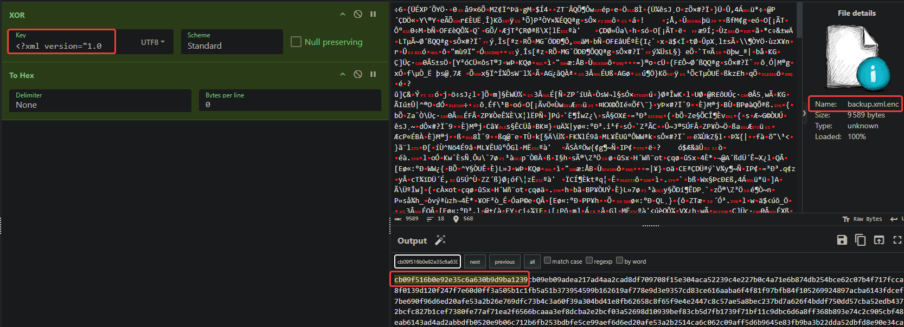

Une simple backup XML de KeePass, très certainement XORed : possible de faire une comparaison par clair connu.

NB : A xor B = C ; C xor B = A => C xor A = B (connaitre deux valeurs permet de retrouver la troisième avec l'opérateur XOR) : [autre exemple](https://podalirius.net/fr/writeups/fcsc2021-intro-clair-connu/)

- créer backup d'une database keepass en XML
- prendre la première ligne, s'en servir comme clé XOR avec la backup chiffrée
- récupérer une taille conséquente pour la clé hexa (~50 caractères)
- retirer des caractères 1 par 1 à la fin de la clé jusqu'à ce que ça déchiffre la vraie backup
- profit : `CYBN{X0R_yOU_ShoULd_N0T_YouR_B1Ckup5}`

Passphrase : `JeSuisLaCybernight9LaVraie` -> (PBKDF2 SHA256) Password : `1f461f9e6490378deaed5a7216cad56829a8e16a0489dd6b5f6be29682e2a165` (inutile pour le challenge)

Flag : `CYBN{X0R_yOU_ShoULd_N0T_YouR_B1Ckup5}`

Passphrase : `JeSuisLaCybernight9LaVraie` -> (PBKDF2 SHA1) XOR KEY : `cb09f516b0e92e35c6a630b9d9ba1239` (seule la clé est à retrouver)

Voilà une façon de retrouver la clé en connaissant les premiers bytes d'un fichier XML standard, à l'aide de Cyberchef :
