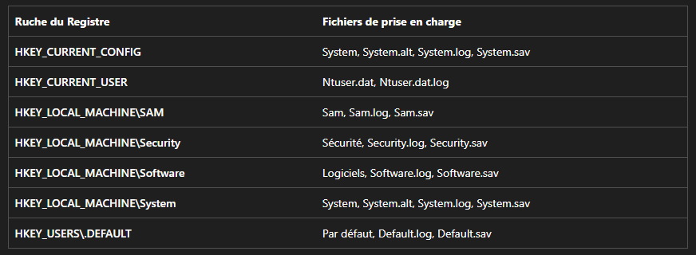
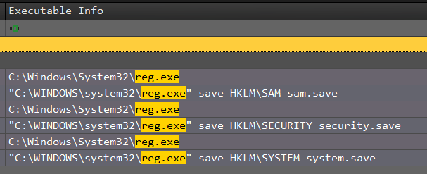

On peut convertir le fichier .evtx en .csv avec des outils comme **[EVTXecmd](https://github.com/EricZimmerman/evtx)** ou **[Hayabusa](https://github.com/Yamato-Security/hayabusa)**, ou encore le convertir en .xml avec powershell par exemple

Une fois en capacité de lire le fichier facilement en clair, on peut se tourner vers le processus powershell très étrange, sinon rechercher sur internet à quoi correspondes les "ruches" et comment les exfiltrer.

Les "ruche" signifient les "hive" de Windows, et une rapide recherche/demande à GPT indique souvent le même processus pour les xporter : **reg.exe**
Ces ruches sont aussi connues, dont voici une liste : 

[source](https://learn.microsoft.com/fr-fr/windows/win32/sysinfo/registry-hives)

On peut alors soit d'intéresser au processus **reg.exe**, soit aux noms de ruches connues, pour trouver les événements associés ici :

Voici docn les trois commandes qui ont permi d'exporter les trois ruches : `SAM`, `SECURITY`, `SYSTEM`

Une fois cela trouvé, le processus parent se trouve dans ces mêmes colones : il s'agit du powershell étrange évoqué plus haut, avec pour PID **4716**

Flag : `CYBN{SAM_SECURITY_SYSTEM_4716}`