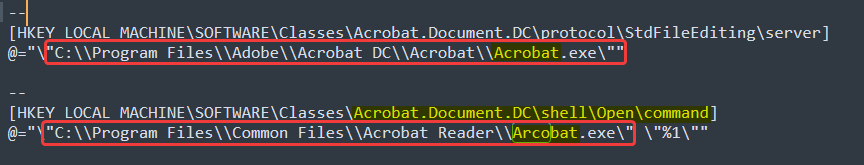

Dans les dossiers de l'utilisateur, ces "fichiers de travail" ce ne sont que des PDF, et il a un installateur pour Acrobat PDF

Parmi les clés de registre récupérées, certaiunes permettent de définir les actions du clic droit sur fichier depuis "explorer.exe" ou simplement le programme par défaut quand l'on ouvre un ficheir avec une certaine extension

Vous l'avez vu venir à ce stade, le malwre se cache parmi les clés qui ouvrent les fichiers PDF

Le chemin `C:\Program Files\Adobe\Acrobat DC\Acrobat\Acrobat.exe\` est à peu près partout, ainsi en regardant de plus près, un autre fichier est parfois défini

Voici par exemple une clé de registre qui définit avec quoi ouvrir les fichiers de type Acrobat.Document.DC, sa commande "shell" quand on veut "Open" le document :


`Arcobat.exe` existe deux fois, très peu our que ce soit normal, et surtout vla la faute d'orthographe


```
--
[HKEY_LOCAL_MACHINE\SOFTWARE\Classes\Acrobat.Document.DC\shell\Open\command]
@="\"C:\\Program Files\\Common Files\\Acrobat Reader\\Arcobat.exe\" \"%1\""
```

Flag : `CYBN{C:\Program Files\Common Files\Acrobat Reader\Arcobat.exe}`

1. La clé fonctionnait vraiment sur la VM
2. Si vous comparez avec une vraie install de Acrobat, aucun fichier n'est installé dans `C:\Program Files\Common Files\Acrobat Reader`