# Writeup : L'image ne fait pas le moine

- [Writeup : L'image ne fait pas le moine](#writeup-limage-ne-fait-pas-le-moine)
- [Enoncé du challenge](#enoncé-du-challenge)
   - [Bilan des fichiers donnés](#bilan-des-fichiers-donnés)
   - [Solving](#solving)
      - [1. Première analyse de la capture](#1-première-analyse-de-la-capture)
      - [2. Analyse de l'attaque menée par la machine malveillante](#2-analyse-de-lattaque-menée-par-la-machine-malveillante)
      - [3. Livraison d'images Docker malicieuses](#3-livraison-dimages-docker-malicieuses)
      - [4. Analyse des layers de l'image malicieuse](#4-analyse-des-layers-de-limage-malicieuse)
      - [5. Reverse-engineering du binaire](#5-reverse-engineering-du-binaire)
      - [6. Récupérer les données exfiltrées](#6-récupérer-les-données-exfiltrées)
   - [Trivia](#trivia)
      - [Inspiration du challenge](#inspiration-du-challenge)
      - [Modification de l'image malveillante](#modification-de-limage-malveillante)
      - [Easter egg](#easter-egg)

# Enoncé du challenge

A la NeuillCorp, étant plutôt famous, **on se fait régulièrement attaquer par des ptits malandrins.**

Regarde ce qu'on a retrouvé dans notre baie de serveur... une ptite dinguerie (cf `hidden_rasp.png`). Bien planquée :d

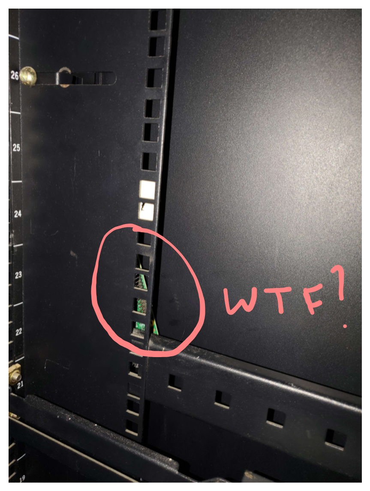

**On sait pas trop depuis combien de temps elle est là, ni ce qu'elle fait, et c'est ton job de nous aider là dessus.**

On suspecte qu'elle foute le bordel sur **notre réseau**, peut-être qu'elle infecte des machines, peut-être même que c'est lié à nos derniers leaks de secrets...

Enfin le plus important, **on a capturé tout le trafic réseau depuis l'une des machines d'un développeur**, pour voir si des trucs se passaient, **ton analyse commence avec cette capture `chall.pcap`**.

Tu as aussi les infos pour déchiffrer le trafic TLS dans le fichier `tls.log`.

Ha et pour te fournir un peu plus de contexte, on te file aussi notre **manuel de nouvel arrivant : `manuel.pdf`**, qu'on file à tout dév qu'on recrute, ça te donnera une idée des outils qu'on utilise. Ca t'aidera peut-être à analyser la capture.

---

**NB** : le challenge, c'est uniquement la capture réseau. Le reste c'est pour du lore et du contexte pour aider un peu à comprendre la capture. (commencez pas à chercher des trucs dans l'image ou ailleurs, tout dans la capture réseau)

## Bilan des fichiers donnés

4 fichiers sont donnés, la capture réseau contient tout ce dont on aura besoin pour le challenge :

- `challenge.pcap` : tout est dedans, plutôt grosse capture (>1Go, >111k paquets)
- `tls.log` : pour déchiffrer le trafic TLS contenu dans la capture
- `manuel.pdf` : on voit plusieurs configurations demandées, on y reviendra plus tard dans le write-up
- `hidden_rasp.png` : on comprend qu'un device non autorisé a été branché au réseau

💡 **On apprend donc quelques infos sur ce qui va nous attendre dans la capture :**

- une machine malveillante qui doit perturber le trafic d'une façon ou d'une autre (d'après la photo)
- des clients, dont on connaît plus ou moins la configuration, qui font des trucs de dév (notamment : ils utilisent Docker) (d'après le manuel)
- la machine dont provient la capture est la machine d'un des clients (d'après l'énoncé)

## Solving

### 1. Première analyse de la capture

On commence par ouvrir la capture dans Wireshark pour analyse, et on déchiffre le trafic TLS.

> Avec Wireshark c'est dans `Edit` > `Preferences` > `Protocols` > `TLS` > `(Pre)-Master-Secret log filename` > On charge le fichier `tls.log` donné dans l'énoncé du challenge.

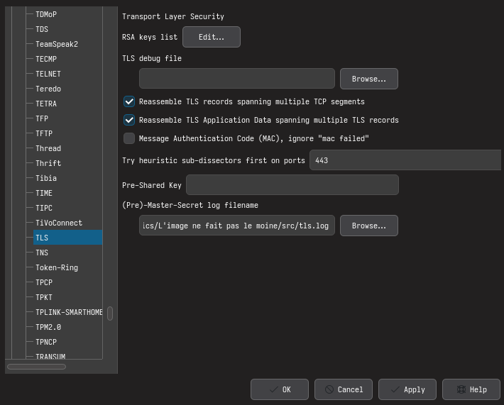

La capture s'étend sur ~500 secondes, donc ~8 minutes. Ce temps de 8 minutes nous servira de référence pour quelques raisonnements.

Une analyse statistique des protocoles dans Wireshark (`Statistics` > `Protocol Hierarchy`) révèle principalement :

- beaucoup de trafic HTTP(S) et QUIC
- un tout ptit peu d'ICMP
- pas mal d'ARP (246 paquets)
- pas mal de DNS (688 paquets)
- pas mal de NTP (224 paquets)
- d'autre trafic minoritaire (un peu de STP par ex)

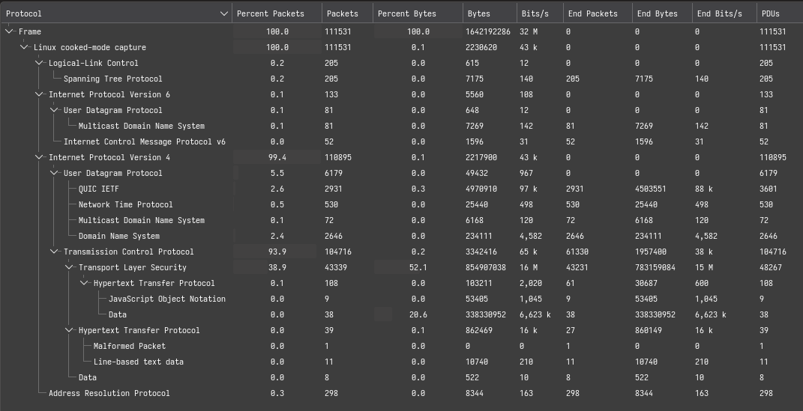

💡 **On continue d'analyser la capture, on comprend sans mal que le client depuis lequel la capture a été réalisée porte l'adresse IP `10.10.10.170` et la MAC `52:54:00:ed:af:4b`.**

C'est par exemple très évident avec `Statistics` > `Conversations` > `TCP` :

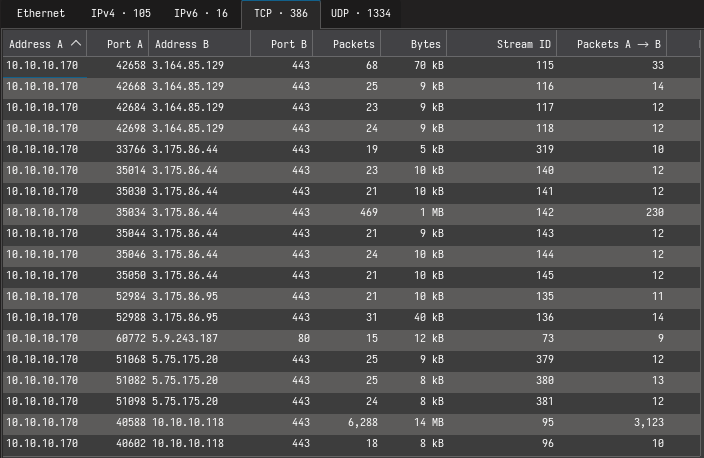

> "évident" car cette IP utilise beaucoup de ports qui paraissent random et très grands dans la capture (typique d'un client). On le voit faire aussi des requêtes NTP (123/udp en destination) DNS (53/udp en destination), en plus de beaucoup de connexions HTTP/HTTPS (port 80 et 443 en destination).

On peut noter que notre client `10.10.10.170` discute beaucoup avec `10.10.10.1` et `10.10.10.118`.

---

💡 **En inspectant avec un peu plus d'attention, on repère un ARP spoof/MITM :**

> Spamming d'arp `is-at` (reply) alors qu'aucun `who-has` (request) n'a été effectué. C'est un ARP poisoning manifeste.

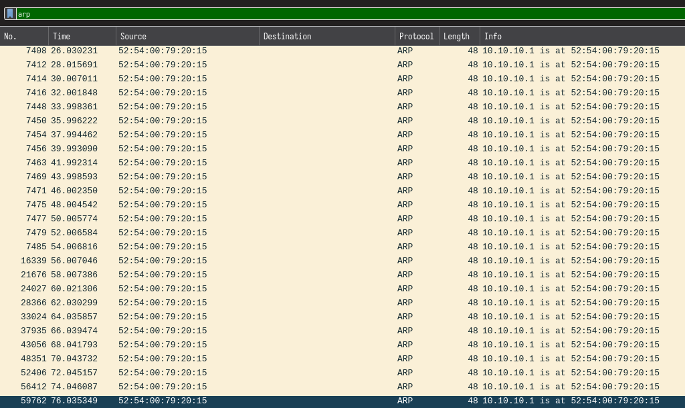

- `52:54:00:79:20:15` spoof l'adresse IP `10.10.10.1` qui est probablement la passerelle (on peut le confirmer avec le reste de la capture)
- `52:54:00:79:20:15` porte normalement l'adresse IP `10.10.10.118` (on peut le voir dans plusieurs messages dans la suite de la capture)

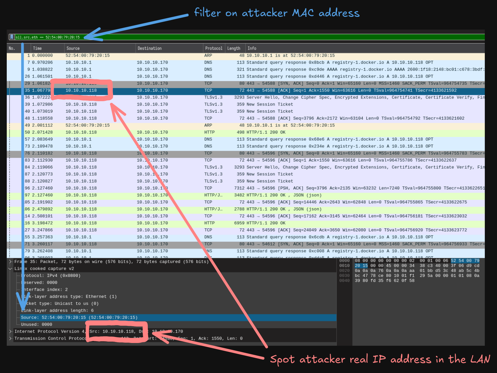

💡 **On sait désormais que :**

- `10.10.10.118`/`52:54:00:79:20:15` est donc notre attaquant
- il est en ARP MITM entre `10.10.10.1` (passerelle) et `10.10.10.170` (machine qui effectue la capture : la victime)

On va désormais se focus sur les paquets que l'attaquant et la victime s'échangent avec un filtre comme `eth.addr == 52:54:00:79:20:15 && eth.addr == 52:54:00:ed:af:4b`

⛳ **Flag 1 : `IP|MAC` de la machine attaquant : `10.10.10.118|52:54:00:79:20:15**

### 2. Analyse de l'attaque menée par la machine malveillante

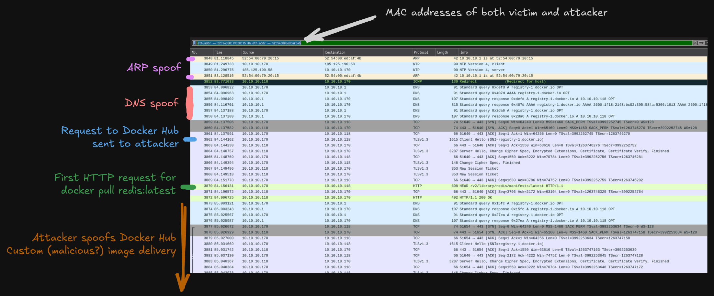

Au menu on a :

- l'attaquant usurpe l'identité de la passerelle (ARP spoof)
- l'attaquant usurpe l'identité du Docker Hub (DNS spoof sur des noms comme `registry-1.docker.io`)
- l'attaquant reçoit et répond les requêtes HTTP/HTTPS du client comme un registre normal

> On a appris dans le `manuel.pdf` que les développeurs utilisaient une conf du démon Docker avec `--insecure-registries` ce qui désactive certaines vérifications de confiance lors de commandes comme `docker pull`. Cela rend donc possible cette attaque.

💡 **On comprend où l'attaque nous mène : les victimes téléchargent des images Docker qui doivent paraître légitimes, mais récupèrent en réalité des images malicieuses.**

⛳ **Flag 2 : `IP|port|protocol` du registre malveillant : `10.10.10.118|443|TCP`**

> Un `docker pull mysql:latest` pourrait donner une image malveillante par exemple...

Essayons de déterminer quelle image Docker a transité dans cette capture, et particulièrement, quelle image Docker notre hacker a délivré à la victime.

### 3. Livraison d'images Docker malicieuses

La première requête effectuée par un `docker pull` est un `HTTP HEAD` pour récupérer *l'index* de l'image. On peut donc filtrer sur les requêtes HTTP `HEAD` dans Wireshark :

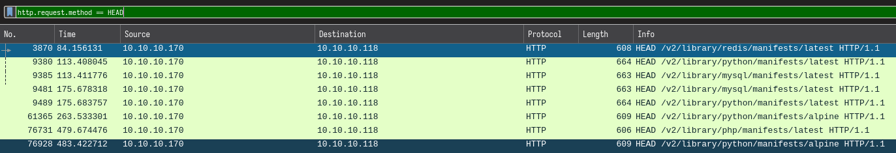

> *L'index* d'une image est généralement un fichier JSON `index.json` qui contient des métadonnées sur l'image, et surtout, le hash de l'image. Le client apprend alors le hash de l'image qu'il demande, ce qui lui permet ensuite de demander à récupérer l'image qui porte ce hash.

💡 **La capture contient donc le téléchargement de cinq images Docker, toutes délivrées par la machine malicieuse, qui semble agir comme un proxy complet vers le Docker Hub :**

- `redis:latest`
- `python:latest`
- `python:alpine`
- `php:latest`
- `mysql:latest`

Quand on effectue un `docker pull`, le flow de requêtes HTTP est toujours le même, on peut le voir clairement dans Wireshark.

Par exemple, dans `File` > `Export Objects` > `HTTP` :

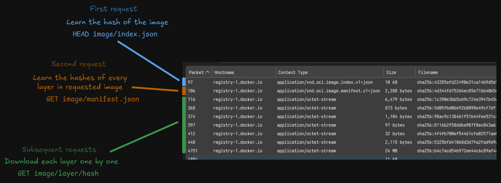

---

En s'appuyant sur les différents timestamps contenus dans la capture, on peut identifier quelles étaient les vraies images `latest` au moment de la capture (le chall a été fait la veille du CTF pour pas compliquer la tâche des participants).

Par exemple pour l'image `redis:latest` : 

- on peut [trouver l'image officielle là sur le Docker Hub](https://hub.docker.com/layers/library/redis/latest/images/sha256-4f7d56132f6280023ded0e5dec0cc973326e9fd539e5874b436d6077b5426ebe)

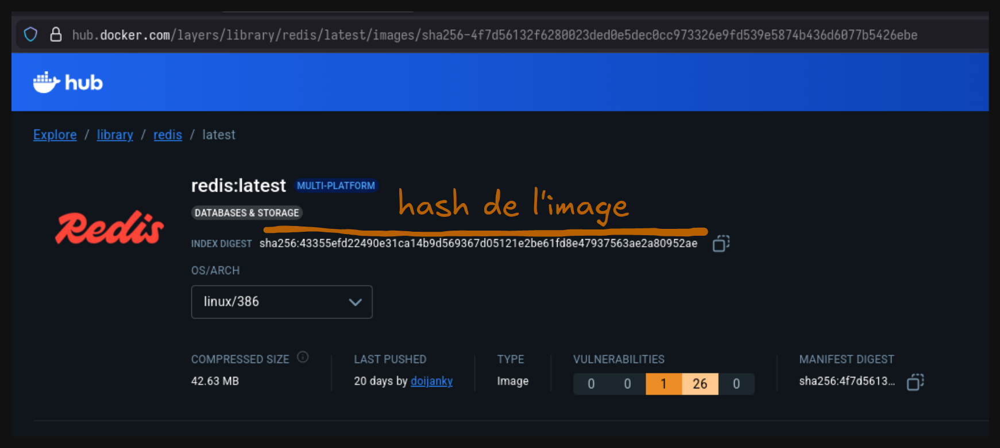

- et on retrouve bien le téléchargement cette image avec ce hash dans la capture (`File` > `Export Objects` > `HTTP`) :

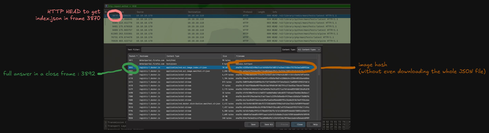

Pour cette image `redis:latest`, les hashes correspondent : l'attaquant ne semble pas avoir altéré l'image `redis:latest`.

---

💡 **En répétant de processus, on trouve en revanche que l'image `mysql:latest` délivrée par l'attaquant n'est pas l'image officielle.**

⛳ **Flag 3 : `hash` de l'image malicieuse contenu dans l'`index.json`: `70d20b6ad8c0dcdd35fee78de7f5cd5c709f2fc2e9d8056e0d2db5778abb14ec`**

On peut aussi le voir directement dans les requêtes HTTP dans Wireshark :

- Request HEAD du client

```http
HEAD /v2/library/mysql/manifests/latest HTTP/1.1
Host: registry-1.docker.io
User-Agent: docker/29.0.2 go/go1.25.4 git-commit/e9ff10b kernel/6.14.0-35-generic os/linux arch/amd64 containerd-client/2.1.5+unknown storage-driver/overlayfs UpstreamClient(compose/v2.40.3)
Accept: application/vnd.docker.distribution.manifest.v2+json, application/vnd.docker.distribution.manifest.list.v2+json, application/vnd.oci.image.manifest.v1+json, application/vnd.oci.image.index.v1+json, */*
Baggage: trigger=api
Traceparent: 00-387ac1923967458c5dc739686a1a54dc-dba8f39586707ef8-01
```

- Réponse du serveur (le hash est visible dans le header HTTP `Docker-Content-Digest`)

```http
HTTP/1.1 200 OK
Server: nginx/1.29.3
Date: Thu, 20 Nov 2025 14:28:02 GMT
Content-Type: application/vnd.docker.distribution.manifest.v2+json
Content-Length: 2412
Connection: keep-alive
Docker-Content-Digest: sha256:70d20b6ad8c0dcdd35fee78de7f5cd5c709f2fc2e9d8056e0d2db5778abb14ec
Docker-Distribution-Api-Version: registry/2.0
Etag: "sha256:70d20b6ad8c0dcdd35fee78de7f5cd5c709f2fc2e9d8056e0d2db5778abb14ec"
X-Content-Type-Options: nosniff
```

---

> Après le `index.json`, un `docker pull` télécharge immédiatement le *manifest* de l'image. C'est un fichier `manifest.json`, qui contient toutes les métadonnées de l'image, et surtout, la liste des *layers* qui composent l'image. On peut le récupérer facilement dans Wireshark, toujours avec `File` > `Export Objects` > `HTTP`.

Le *manifest* de l'image MySQL, comparé au *manifest* original, révèle deux layers altérés : le premier et le dernier.

```bash
# On télécharge l'image officielle
❯ docker pull mysql:latest

# On regarde la liste des layers contenus dans l'image
❯ docker inspect mysql | jq '.[0].RootFS | {Layers}' 

{
  "Layers": [
    "sha256:981a008ea98331f124a741e8be0534f6c31ddfdef6cab2fd3a972cef8becc114",
    "sha256:3d259228ea096ff8535c8aec7f30ced52adbae22cb2866f445491f94a51aa95d",
    "sha256:b8cbefeb49fb63132ef44c0da89fba9718f352a1a6f2280c500e143fcef40c12",
    "sha256:33f977c1c2ada6f9025246d35ab9dc4d32d446f874dffc72a857199291054d45",
    "sha256:7a17fd04a9ee0edd27713dd6a7ce4174706bc638aa15d726265d1a3f2d874048",
    "sha256:8f0c312499e501fc9d2db4b4e2132dd43294b74a638e671b11bf73b4fe929ea0",
    "sha256:8c381f87ac0f0251bed1f5bb67e285dfd1bbaece46fd9e2a4d86417d8c35e772",
    "sha256:dd28c3f78fd5d3026fc63dc0565e2b9eb86a9ae6dd68eb89cbaacf98ce8da93a",
    "sha256:ed084abf2c5abfe60baa0be6b06e1369e11b0e01dbdf09a6f412bba1dcd44e8d",
    "sha256:30a340903f4832b518a0f3f1b65f9be757532abeb26f83477c799b991a8a4e3e"
  ]
}

# On peut aussi exporter l'image Docker sur disque
# Ca permet d'avoir le manifest.json accessible directement, même format que celui de la capture
❯ docker save mysql:latest -o original/mysql.tar

# On extrait l'archive ("docker save" produit un tar)
❯ cd original
❯ tar xvf mysql.tar
[...]

❯ cat original/manifest.json | jq '.[] | {Layers}' 
{
  "Layers": [
    "blobs/sha256/981a008ea98331f124a741e8be0534f6c31ddfdef6cab2fd3a972cef8becc114",
    "blobs/sha256/3d259228ea096ff8535c8aec7f30ced52adbae22cb2866f445491f94a51aa95d",
    "blobs/sha256/b8cbefeb49fb63132ef44c0da89fba9718f352a1a6f2280c500e143fcef40c12",
    "blobs/sha256/33f977c1c2ada6f9025246d35ab9dc4d32d446f874dffc72a857199291054d45",
    "blobs/sha256/7a17fd04a9ee0edd27713dd6a7ce4174706bc638aa15d726265d1a3f2d874048",
    "blobs/sha256/8f0c312499e501fc9d2db4b4e2132dd43294b74a638e671b11bf73b4fe929ea0",
    "blobs/sha256/8c381f87ac0f0251bed1f5bb67e285dfd1bbaece46fd9e2a4d86417d8c35e772",
    "blobs/sha256/dd28c3f78fd5d3026fc63dc0565e2b9eb86a9ae6dd68eb89cbaacf98ce8da93a",
    "blobs/sha256/ed084abf2c5abfe60baa0be6b06e1369e11b0e01dbdf09a6f412bba1dcd44e8d",
    "blobs/sha256/30a340903f4832b518a0f3f1b65f9be757532abeb26f83477c799b991a8a4e3e"
  ]
}

# Le manifest de l'image infectée
# Le premier et le dernier layer ont été altérés (les hashes ont changé)
❯ cat manifest.json | jq '.[0] | {Layers}'           
{
  "Layers": [
    "blobs/sha256/0e1118bfb9158b90bd39a1f57bac2161695121c8d0ba9bdb8d848098a6663f2f",
    "blobs/sha256/3d259228ea096ff8535c8aec7f30ced52adbae22cb2866f445491f94a51aa95d",
    "blobs/sha256/b8cbefeb49fb63132ef44c0da89fba9718f352a1a6f2280c500e143fcef40c12",
    "blobs/sha256/33f977c1c2ada6f9025246d35ab9dc4d32d446f874dffc72a857199291054d45",
    "blobs/sha256/7a17fd04a9ee0edd27713dd6a7ce4174706bc638aa15d726265d1a3f2d874048",
    "blobs/sha256/8f0c312499e501fc9d2db4b4e2132dd43294b74a638e671b11bf73b4fe929ea0",
    "blobs/sha256/8c381f87ac0f0251bed1f5bb67e285dfd1bbaece46fd9e2a4d86417d8c35e772",
    "blobs/sha256/dd28c3f78fd5d3026fc63dc0565e2b9eb86a9ae6dd68eb89cbaacf98ce8da93a",
    "blobs/sha256/ed084abf2c5abfe60baa0be6b06e1369e11b0e01dbdf09a6f412bba1dcd44e8d",
    "blobs/sha256/573972b1f7d32f4390a7a00fc50104e88d61044c6b1d86762e12b3f40bb04ac5"
  ]
}
```

On va rester simple, et simplement télécharger ces deux layers depuis la capture Wireshark (toujours depuis `File` > `Export Objects` > `HTTP`), et comparer avec l'image officielle.

> Je détaille pour le writeup, mais pour solve, juste le fichier `index.json` encore plus simpliste, suffisait à voir que l'image avait été altérée : le fichier `index.json`, requêté en premier, contient le hash global de l'image, qui a forcément changé aussi, si l'image a été altérée.

### 4. Analyse des layers de l'image malicieuse

On va donc extraire de la capture (toujours avec `File` > `Export Objects` > `HTTP`) et analyser le contenu du premier et du dernier *layer* :

- premier : `0e1118bfb9158b90bd39a1f57bac2161695121c8d0ba9bdb8d848098a6663f2f`
- dernier : `573972b1f7d32f4390a7a00fc50104e88d61044c6b1d86762e12b3f40bb04ac5`

Le dernier layer ne contient que le `docker-entrypoint.sh` :

```bash
# On isole le layer intéressant (le dernier)
❯ cp 573972b1f7d32f4390a7a00fc50104e88d61044c6b1d86762e12b3f40bb04ac5 last/last.tar

# Extraction
❯ cd last
❯ tar xvf last.tar
./
./usr/
./usr/local/
./usr/local/bin/
./usr/local/bin/docker-entrypoint.sh
```

On peut comparer avec le [`docker-entrypoint.sh`](https://raw.githubusercontent.com/docker-library/mysql/70c7d9777ced9f553109306404fe3c8700b3e9f7/innovation/docker-entrypoint.sh) officiel :

```bash
❯ curl -SLO 'https://raw.githubusercontent.com/docker-library/mysql/70c7d9777ced9f553109306404fe3c8700b3e9f7/innovation/docker-entrypoint.sh'

❯ diff docker-entrypoint.sh usr/local/bin/docker-entrypoint.sh 
242d241
< 
287a287,288
>   uname &
> 
420a422
> 
```

💡 **Un process `uname`, sans argument ni options, lancé en fond, ajouté en vrac au milieu de l'entrypoint Docker (ligne 287). On dirait qu'on tient notre coupable.**

En effet, l'autre layer infecté, le premier, contient le fichier `uname` malveillant :

```bash
# On isole le layer intéressant (le premier)
❯ cp 0e1118bfb9158b90bd39a1f57bac2161695121c8d0ba9bdb8d848098a6663f2f first/first.tar

# Extraction du contenu
❯ cd first
❯ tar xvf first.tar
[...]

# Puis on peut chercher le fameux uname avec find :
❯ find . -name uname
./usr/bin/uname

# il ne fait... rien quand on le lance ? Ce n'est pas un "uname" normal
❯ ./usr/bin/uname -ar
^C

# pour le flag
❯ cat uname | sha256sum
443623bab69b4be4075b7b120d1f02b3f8aab4c48090251c31776e81c1497020  -
```

> `uname` sert habituellement à print des infos sur la machine, notamment la version du kernel par exemple. Un `uname -ar` peut retourner quelque chose comme `Linux ito-Standard-PC-Q35-ICH9-2009 6.14.0-35-generic #35~24.04.1-Ubuntu SMP PREEMPT_DYNAMIC Tue Oct 14 13:55:17 UTC 2 x86_64 x86_64 x86_64 GNU/Linux`.

💡 **Puisqu'il est lancé en fond par le `docker-entrypoint.sh`, il est donc systématiquement lancé quand un conteneur démarre à partir de l'image `mysql:latest`.**

⛳ **Flag 4 : `hash` du malware `443623bab69b4be4075b7b120d1f02b3f8aab4c48090251c31776e81c1497020`**

Suite des opération : reverse ce binaire `uname` suspicieux.

### 5. Reverse-engineering du binaire

C'est manifestement un binaire Go, avec très peu de fonctions, on comprend assez vite avec les signatures des fonctions qu'il s'agit d'un malware qui vole et exfiltre des secrets.

On va donc essayer de déterminer un peu ce qu'il fait, essentiellement avec Ghidra et [Delve](https://github.com/go-delve/delve) :

💡 **Les fonctions custom facilement identifiables sont :**

```bash
# on lance une session de debug avec Delve
❯ dlv exec uname
(dlv) funcs
[...]
neuillXfiltration/common.(*NTPPacket).GetNonce
neuillXfiltration/common.(*NTPPacket).PatchPacketEncrypted
neuillXfiltration/common.(*NTPPacket).setLengthBitEncrypted
neuillXfiltration/common.(*NTPPacket).setLengthBitRaw
neuillXfiltration/common.Encrypt
neuillXfiltration/common.GenerateClientPkt
neuillXfiltration/common.GetKey
neuillXfiltration/common.GetNTPTime
neuillXfiltration/importable_sender.(*Sender).GetRandomDelay
neuillXfiltration/importable_sender.(*Sender).ReliableSendBuffer
neuillXfiltration/importable_sender.(*Sender).SendBytes
neuillXfiltration/importable_sender.(*Sender).doSendMessage
neuillXfiltration/importable_sender.(*Sender).sendMessage
neuillXfiltration/importable_sender.(*Sender).sendMessage.deferwrap1
neuillXfiltration/importable_sender.(*Sender).waitForAck
neuillXfiltration/importable_sender.NewSender
neuillXfiltration/importable_sender.checkDelays
neuillXfiltration/secrets.FindSecrets
neuillXfiltration/secrets.expandPath
neuillXfiltration/secrets.isSensitiveEnv
[...]
```

Il est possible de réussir à reverse l'algo et comprendre la logique avec du debug/reverse/disassemble, mais avec un peu de recherches, le code original est dispo sur Github :

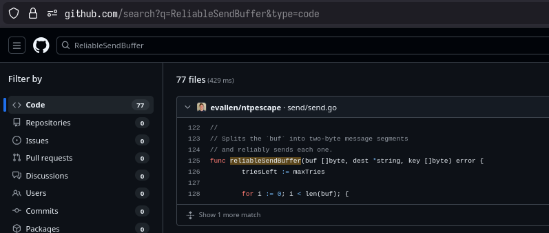

💡 **On apprend donc :**

- l'exfiltration se fait avec des requêtes NTP (explique la quantité de paquets NTP dans la capture)
- les données sont chiffrées avec un AES-CTR, il nous reste à trouver la clé de chiffrement, qui est hardcodée dans le programme

💡 **Le code de [ntpescape](https://github.com/evallen/ntpescape) semble avoir été étendu pour précisément rajouter :**

```bash
neuillXfiltration/secrets.FindSecrets
neuillXfiltration/secrets.expandPath
neuillXfiltration/secrets.isSensitiveEnv
```

Le code semble avoir été patché pour ajouter une récupération de secrets.

> L'exfiltration est donc une exfiltration NTP. D'après le code, l'exfiltration a lieu 2 bytes par 2 bytes, dans le champ *fractional time* d'une requête NTP souvent randomisé ou mis à 0 par la plupart des clients légitimes. Dans [**la RFC**](https://www.rfc-editor.org/rfc/rfc958.html) y'a écrit de mettre 2 bytes à zero ou du random si la clock de la machine ne peut pas le remplir (genre quand c'est pas initialisé, ou quand la clock de la machine n'est pas assez précise : c'est précis à 0.2 nanosecondes). D'autre part, le malware chiffre avant d'exfiltrer les données. L'utilisation de AES-CTR permet que chaque paquet soit chiffré indépendamment les uns des autres, pas de cohérence globale requise pour le déchiffrement. Chaque paquet reçu contient le nonce + des données chiffrées.

💡 **On peut utiliser [Delve](https://github.com/go-delve/delve) pour debug le programme et récupérer facilement les variables statiques du programme (plus facile qu'avec Ghidra) :**

```bash
❯ dlv exec uname
(dlv) vars
[...]
# notre clé de chiffrement AES
neuillXfiltration/common.KeyString = "10ca15a1adb4df00db1a5edfa11ac1e5"

# ça fait "local salad bad food biased fallacies" en leet, probablement un hacker anti-écolo :d
 ```

⛳ **Flag 5 : `clé` de chiffrement utilisé par le malware `10ca15a1adb4df00db1a5edfa11ac1e5`**

> L'exfiltration est effectuée 2 bytes par 2 bytes avec le champ *fraction time* du protocole NTP qui est utilisé : codé sur 2 bytes, 

### 6. Récupérer les données exfiltrées

Effectivement, en regardant désormais avec plus d'attention, on se rend compte qu'on a beaucoup trop de trames NTP dans la capture pour du trafic légitime.

Normalement l'intervalle entre deux requêtes NTP est randomisé par le client NTP de l'OS, est c'est de l'ordre de quelques minutes.

Ici on a souvent des trames à quelques secondes d'intervalle, qui partent vers l'adresse IP `51.159.4.33` (port 123/udp comme du NTP légitime).

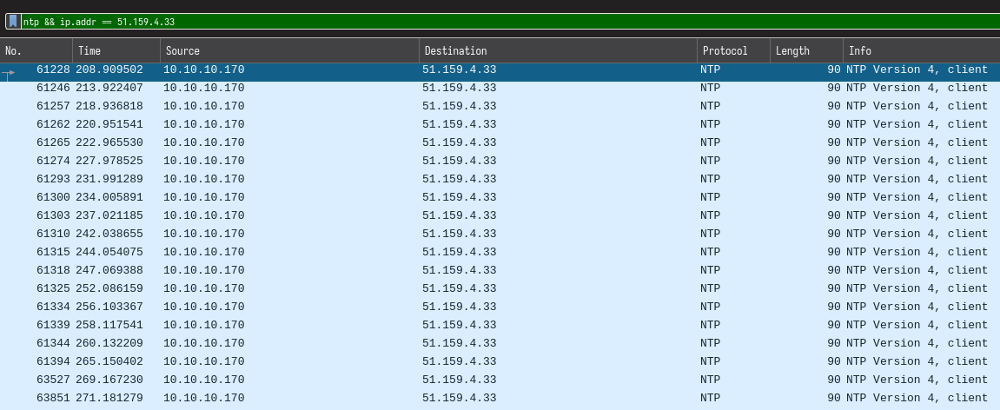

💡 **C'est l'adresse IP du serveur où sont exfiltrées les données. On extrait alors tout le trafic NTP qui part vers cette adresse IP de la capture :**

```bash
# d'abord j'ai filtré dans Wireshark le trafic NTP que j'ai exporté dans une capture only_ntp.pcap (pas forcément nécessaire, juste plus simple pour bosser)
❯ tshark -r only_ntp.pcap -Y "udp.dstport == 123 and ip.dst == 51.159.4.33" -T json  > ntp_packets.json

# export JSON pour faciliter le parsing Python après
```

Il faut désormais réassembler le message chiffré (2 bytes par trame NTP) et déchiffrer en utilisant l'algorithme de chiffrement identifié plus tôt, et la clé.

En se basant sur le projet https://github.com/evallen/ntpescape , j'ai codé un script Python qui fait le job, tout commenté en français et détaillé pour ce writeup :d

> Y'a aussi moyen de lancer le code du dépôt Git direct en le ré-adaptant pour parser une capture ou un JSON, plutôt que servir de serveur qui reçoit l'exfiltration. J'ai préféré recoder un truc dédié :

```python
#!/usr/bin/env python3
# Extrait et déchiffre une exfiltration NTP réalisée avec https://github.com/evallen/ntpescape
#
# Les données sont exfiltrées dans le champ "timestamp" qui fait 8 bytes
# Le champ timestamp est composé de : un "EPOCH time" sur 4 bytes, et un "fraction time" sur 4 bytes
# Plus précisément, c'est la partie "fraction time" (précis à 0.2 nanoseconde) : les 4 derniers bytes du timestamp
# Ce script extrait donc ces 4 bytes de chaque paquet NTP
#
# Les données sont chiffrées 2 bytes par 2 bytes avant exfiltration 
# Chiffrement : AES-CTR, une clé statique, et un nonce qui est envoyé dans chaque paquet
# Ce script déchiffre indépendamment chaque paquet lu, en utilisant la clé connue, et le nonce contenu dans chaque paquet
# Chaque paquet déchiffré contient 2 bytes de données
#
# Format du champ "fraction time NTP" utilisé dans l'exfiltration étudiée :
#
#         Données chiffrées exfiltrées          L                   Nonce
# --------------------------------------------- -- --------------------------------------------
# 0 1  2  3  4  5  6  7  8  9 10 11 12 13 14 15 16 17 18 19 20 21 22 23 24 25 26 27 28 29 30 31
#
# Le bit 16 (L) indique si le paquet contient 1 ou 2 bytes de données :
# - L=0 : 2 bytes de données utiles
# - L=1 : 1 seul byte utile, le second est du padding
# Ce bit est également chiffré avec AES-CTR, en utilisant le 3ème byte 
# du keystream généré avec le même nonce.

import struct
import binascii
import json
from cryptography.hazmat.primitives.ciphers import Cipher, algorithms, modes
from cryptography.hazmat.backends import default_backend

def get_nonce(tx_time_sec, tx_time_frac):
    """Reconstitue le nonce AES-CTR à partir d'un paquet exfiltré
    
    Structure du nonce (16 bytes):
    bytes 0-3 : champ "EPOCH time" du paquet exfiltré (32 bits, big-endian)
    bytes 4-5 : bits 17-31 du champ fraction time (15 bits, "masqués")
    bytes 6-15 : padding à zéro (10 bytes)
    
    "masqués" : Le masque 0xFFFE efface le bit 0 des bits 16-31 : le bit de longueur dans le paquet original.
    Exemple : Si bits 16-31 = 0bxxxxxxxLxxxxxxxx (où L est le bit de longueur), 
              après masque : 0bxxxxxxx0xxxxxxxx
    """

    # Initialisation de 16 bytes à 0
    nonce = bytearray(16)

    # Les 4 premiers bytes du nonce: champ "EPOCH time" du paquet NTP
    nonce[0:4] = struct.pack('>I', tx_time_sec)

    # 2 bytes suivants: bits 17-31 du champ "fraction time"
    # On décale de 16 bits et on masque pour enlever le bit de longueur
    # dans le code Go original il fait: packet.TxTimeFrac&^0x1FFFF
    frac_upper = (tx_time_frac >> 16) & 0xFFFE
    nonce[4:6] = struct.pack('>H', frac_upper)

    # Le reste du nonce (les 10 bytes restants) sont padded avec des 0, déjà fait dans notre cas avec bytearray(16)
    # Le nonce est donc complètement reconstruit, on peut ret
    return bytes(nonce)

def decrypt_ntp_packet(tx_time_sec, tx_time_frac, key):
    """Déchiffre les données contenues dans un paquet NTP exfiltré
    
    Args:
        tx_time_sec: timestamp NTP en secondes (32 bits)
        tx_time_frac: partie fractionnaire du timestamp (32 bits)
        key: clé AES de 16 bytes
    
    Returns:
        bytes: 1 ou 2 bytes de données déchiffrées
    """

    # Extraction des 2 bytes de données chiffrées (bits 0-15)
    encrypted_bytes = struct.pack('>I', tx_time_frac)[2:]  # 2 bytes
    
    # Construction du nonce
    nonce = get_nonce(tx_time_sec, tx_time_frac)
    
    # Création du chiffreur AES-CTR avec la lib cryptography
    cipher = Cipher(algorithms.AES(key), modes.CTR(nonce), backend=default_backend())
    encryptor = cipher.encryptor()
    
    # Génération de 3 bytes de keystream (2 pour les données + 1 pour le bit de longueur)
    keystream = encryptor.update(b'\x00\x00\x00') + encryptor.finalize()
    
    # Déchiffrement des 2 bytes de données
    # En AES-CTR, déchiffrer = chiffrer = XOR avec le keystream
    decrypted_chunk = bytes([
        encrypted_bytes[0] ^ keystream[0],
        encrypted_bytes[1] ^ keystream[1]
    ])
    
    # Déchiffrement du bit de longueur (bit 16)
    # Le bit 16 du champ fraction time est chiffré avec le 3ème byte du keystream
    encrypted_length_bit = (tx_time_frac >> 16) & 0x1
    keystream_length_bit = keystream[2] & 0x1
    decrypted_length_bit = encrypted_length_bit ^ keystream_length_bit
    
    if decrypted_length_bit == 0:
        # bit = 0 : 2 bytes de données
        return decrypted_chunk
    else:
        # bit = 1 : 1 seul byte de données (le second est du padding)
        return decrypted_chunk[:1]

def extract_ntp_timestamps_from_payload(udp_payload_hex):
    try:
        # Ptit cleaning (on enlève le : des chars hexa)
        hex_clean = udp_payload_hex.replace(':', '')
        payload_bytes = bytes.fromhex(hex_clean)
        
        # Un paquet NTP valide c'est exactement 48 bytes
        # donc ptit check additionnel pour être certain d'extraire les bons payloads
        if len(payload_bytes) < 48:
            return None, None
        
        # On récupère les différents champs du paquet NTP
        # L'exfiltration est réalisé dans le timestamp : les 8 derniers bytes
        tx_timestamp = payload_bytes[-8:]
        tx_sec = struct.unpack('>I', tx_timestamp[0:4])[0] # first 4 bytes : epoch timestamp
        tx_frac = struct.unpack('>I', tx_timestamp[4:8])[0] # last 4 byres : fractional time
        
        return tx_sec, tx_frac

    except Exception as e:
        print(f"Payload invalide, pas réussi à extraire: {e}")
        return None, None

def parse_json_packets(filename, key):

    # L'input doit être un fichier JSON produit par tshark
    with open(filename, 'r') as f:
        packets_data = json.load(f)
    
    decrypted_data = bytearray()
    packet_count = 0
    
    for packet in packets_data:
        try:
            # On récupère que le contenu UDP des paquets (l'exfiltration se fait en NTP : port 123/UDP)
            layers = packet.get('_source', {}).get('layers', {})
            udp_layer = layers.get('udp', {})
            
            if 'udp.payload' not in udp_layer:
                continue
                
            # Récupération du payload NTP
            udp_payload_hex = udp_layer['udp.payload']
            
            # Extraction des deux seuls champs intéressants pour l'exfiltration : le timestamp (sur deux champs : temps en secondes + temps fractionnel)
            tx_sec, tx_frac = extract_ntp_timestamps_from_payload(udp_payload_hex)
            
            if tx_sec is not None and tx_frac is not None:
                # déchiffrement de 1 ou 2 bytes de data chiffrée contenu dans ce paquet
                decrypted_chunk = decrypt_ntp_packet(tx_sec, tx_frac, key)
                decrypted_data.extend(decrypted_chunk)
                packet_count += 1
                
                print(f"Packet {packet_count}: sec=0x{tx_sec:08x} frac=0x{tx_frac:08x} -> decrypted: {decrypted_chunk.hex()} ({repr(decrypted_chunk)})")
                
        except Exception as e:
            print(f"Error processing packet: {e}")
            continue
    
    print(f"\nProcessed {packet_count} packets")
    return bytes(decrypted_data)

def print_results(decrypted_data):
    try:
        decoded_text = decrypted_data.decode('utf-8')
        print(decoded_text)
        
    # Au cas où la data extraite est pétée, on print les bytes en raw direct pour analyse
    except UnicodeDecodeError:
        print(f"\nRaw bytes (not UTF-8 text):")
        print(decrypted_data)
    
def main():
    # La clé récupérée à l'étape précédente
    KEY_HEX = "10ca15a1adb4df00db1a5edfa11ac1e5"
    key = binascii.unhexlify(KEY_HEX)
    
    # Chemin vers le fichier tshark produit juste avant
    input_file = "ntp_packets.json"
    
    decrypted = parse_json_packets(input_file, key)
    print_results(decrypted)

if __name__ == '__main__':
    main()
```

```bash
❯ python decrypt.py
[...]
{"ENV_MYSQL_PASSWORD": "","ENV_MYSQL_ROOT_PASSWORD": "CYBN{d0ck3r_s3cr3ts_3xfiltr4ti0n_1s_n0w_a_cl4ssic}"}
```

⛳ **Flag 6 : Les `données_exfiltrées` : `CYBN{d0ck3r_s3cr3ts_3xfiltr4ti0n_1s_n0w_a_cl4ssic}`**

## Trivia

### Inspiration du challenge

L'inspiration pour ce challenge, c'était un article de Sysdig qui discute des images malicieuses qui traînent sur le Docker Hub.

📜 **Source** : https://www.sysdig.com/blog/analysis-of-supply-chain-attacks-through-public-docker-images

### Modification de l'image malveillante

L'image malveillante a été créée en modifiant manuellement l'image `mysql:latest` avec une technique baptisée `gh0stedit`.

Pour le challenge ça change pas grand chose (même rien, vu qu'on explore les layers à la main), mais l'image, en dehors du layer lui-même, ne comporte aucune trace de modification.

> Genre un `docker history` ne montre rien : l'image a été modifiée manuellement, pas construite avec un `Dockerfile`. Le process c'est de `docker pull` une image, `docker save` sur disque. Extraction manuelle des layers. Modification. Puis on repackage en modifiant manuellement le hash dans le `manifest.json`. Plus qu'à `docker load` l'archive résultante. Expliqué en détail dans l'article ci-dessous.

Ca permet de modifier directement le layer de base par exemple, ce qui est impossible avec un `docker build` depuis un `Dockerfile` (on ne fait qu'ajouter des layers).

Dans l'épreuve, ça a permis de modifier le binaire `uname` qui se trouve dans le tout premier layer dans l'image, directement en le remplaçant dans ce premier layer.

📜 **Source** : https://arxiv.org/html/2506.08218v2

### Easter egg

Y'avait une conversation factice visant à bully un autre membre du staff CyberNight dans la capture, je la remet ici hihi. Avec un `tcp.port == 9999` on peut facilement voir la conversation dans Wireshark :

```
hello tavu Onelots à la cafét ? Il racontait encore nawak

oè j'peux pas croire que les gens lui fassent encore confiance

c'est vraiment un gros débile...

clairement. Bon allez on se retrouve à la pause déj en bas ?

yep allez ! J'suis content qu'on ait trouvé ce moyen de discuter en direct

ouaip c'pratique, mais c'est pas chiffré, les gens pourraient récupérer nos ptits secrets, ou nos flags de discussion aha

ouais genre lui : CYBN{d0_y0u_R3alLy_th1nk_iT_WouLD_b3_th4t_e4sy}

haha c'est ça ! allez à toute
```

