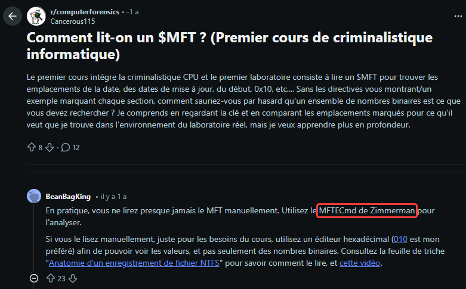

- $MFT file ? how to open it ? google is your friend. 
- using [MFTecmd](https://github.com/EricZimmerman/MFTECmd) : ``MFTECmd.exe -f "`$MFT" --csv "helpdesk" --csvf MFT.csv``
- open it with [TimelineExplorer](https://www.sans.org/tools/timeline-explorer), Excel, nano, or even vim if you dare
- We are talking about "Script ? Update Windows ?" -> Search for `.ps1` or `update` at the end of the file, and you will find `update_windows.ps1` in Downloads folder
- This name refers to `update_windows.ps1:Zone.Identifier` which indicates Downloaded from internet : URL = `https://ppng.io/vHgh6i8.txt` (URL does not respond any data, because it is live stream HTTP data)
- Just after, search for sussy folder path (downloads, public, temp, documents, etc) -> Founds one in `C:\Users\neuill\AppData\Local\Temp` : `C:\Users\neuill\AppData\Local\Temp\o8hjbdqd`
- Looks for sussy files just after, the last is `C:\Program Files\Common Files\ferrari.exe`, size is `150959`

Flag : `CYBN{https://ppng.io/vHgh6i8.txt_C:\Users\neuill\AppData\Local\Temp\o8hjbdqd_C:\Program Files\Common Files\ferrari.exe_150959}`

See [checked_elements.csv](checked_elements.csv)