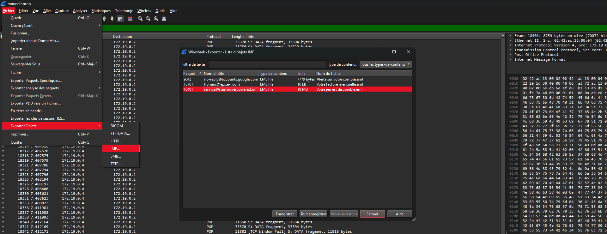
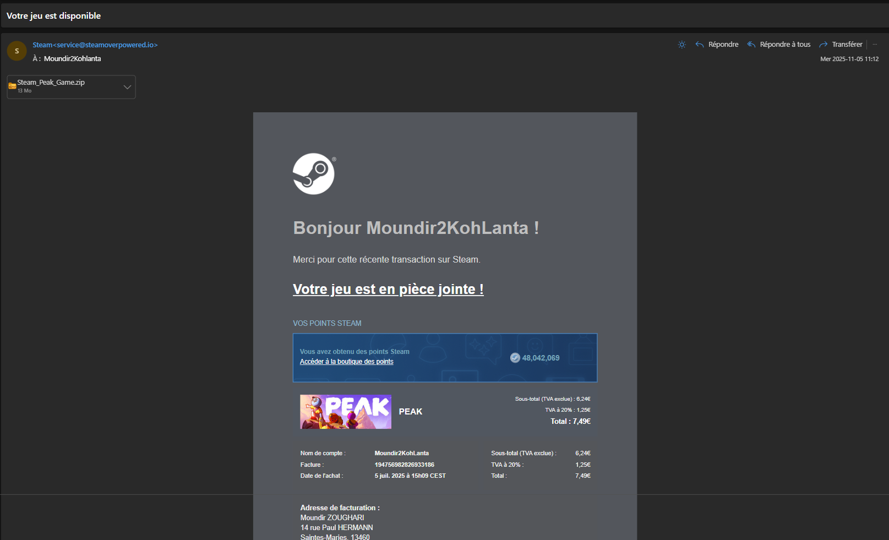
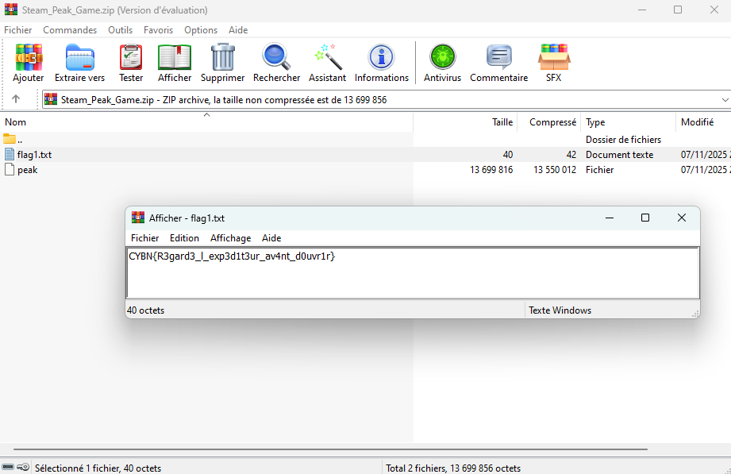

Il faut retrouver les mails reçus en POP3. A savoir que l'on peut exporter directement les .eml via l'onglet Fichier

Ensuite, on ouvre ce .eml avec ce qu'on veut (ici https://www.encryptomatic.com/viewer)

Le mail de steam est en fait du phishing, on a une pièce jointe avec qui est le malware zippé.

Le flag est à l'intérieur du zip.

`CYBN{R3gard3_l_exp3d1t3ur_av4nt_d0uvr1r}`
