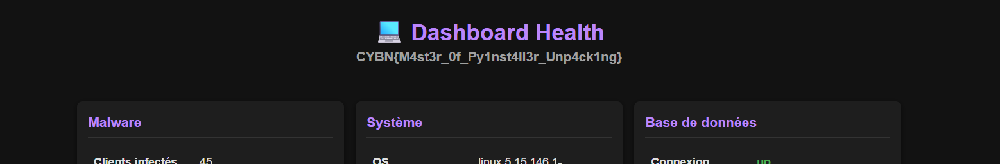

Un petit coup de strings dessus permet de voir que c'est un python compilé

```
$ strings -n 12 peak
[...]
Could not allocate memory for archive structure!
Could not allocate buffer for TOC!
Py_DecodeLocale
Py_IsInitialized
Py_PreInitialize
PyInitConfig_Create
PyInitConfig_Free
PyInitConfig_SetInt
PyInitConfig_SetStr
PyInitConfig_SetStrList
[...]
```

C'est du 3.6, il faut déjà extraire les fichiers compilé du binaire avec PyInstaller Extractor (version web : https://pyinstxtractor-web.netlify.app).

En CLI ça donne :

```
$ python ~/pyinstxtractor_ng.py peak
[+] Processing peak
[+] Pyinstaller version: 2.1+
[+] Python version: 3.6
[+] Length of package: 12663470 bytes
[+] Found 61 files in CArchive
[+] Beginning extraction...please standby
[+] Possible entry point: pyiboot01_bootstrap.pyc
[+] Possible entry point: pyi_rth_subprocess.pyc
[+] Possible entry point: pyi_rth_pkgutil.pyc
[+] Possible entry point: pyi_rth_inspect.pyc
[+] Possible entry point: main.pyc
[+] Found 229 files in PYZ archive
[+] Successfully extracted pyinstaller archive: peak
```

On note le point d'entrée du programme : `main.pyc`

Ensuite, ça se décompile facilement avec **Uncompyle6** ou **https://pylingual.io**.

*Attention, **pylingual** peut faire des erreurs. D'autres décompileur (comme **decompyle3**) peuvent ne pas fonctionner.*

```
$ uncompyle6 main_extracted/main.pyc -o decompiled/main.py
main_extracted/main.pyc --
# Successfully decompiled file
```

Dans le main, on voit la fonction :

```python
import malware.utils as utils

# [...]

def get_health(self) -> str:
    return self.session.get(utils.get_health_url()).text
```

Il faut donc décompiler aussi malware.utils :

```
$ uncompyle6 main_extracted/PYZ-00.pyz_extracted/malware/utils.pyc -o decompiled/malware/utils.py
main_extracted/PYZ-00.pyz_extracted/malware/utils.pyc --
# Successfully decompiled file
```

Maintenant on récupère simplement les bouts de code qui nous intéresse et on exécute :

```python
from random import Random

_OBF_TABLE = bytes([
  142, 14, 147, 113, 72, 250, 158, 215, 114, 133, 203, 101, 176, 
  121, 125, 223, 155, 16, 201, 73, 76, 237, 27, 204, 185, 209,
  210, 150, 58, 12, 152, 37, 15, 161, 114, 1, 10, 80, 62, 171, 
  222, 121, 233, 245, 27, 189, 244, 49, 172, 28, 83, 49, 193, 64,
  55, 6, 67, 165, 28, 232, 153, 107, 45, 7, 153, 9, 123, 183,
  234, 131, 0, 117, 93, 226, 109, 145, 138, 109, 175, 190, 84,
  22, 56, 190, 217, 157, 150, 160, 120, 58, 180, 138, 142, 198,
  71, 51, 92, 41, 112, 140, 116, 5, 26, 217, 239, 61, 22, 62,
  149, 9, 78, 49, 174, 193, 106
])

def xor(a: bytes, b: bytes):
  return bytes([a[i] ^ b[i] for i in range(len(a))])


def randbytes(seed: int, n: int) -> bytes:
  r = Random(seed)
  return bytes(r.getrandbits(8) for _ in range(n))

def get_health() -> str:
  s = 18
  rand = randbytes(49374, s)
  return xor(_OBF_TABLE[97:97 + s], rand).decode()


get_url()
get_health()

# Output :
# '/health-NkqbF7mXmz'
```

L'URL du site se trouve dans le PCAP, ou l'on peut faire la même chose avec la fonction **`get_url()`** de **`utils.py`**.

Plus qu'à visiter le site sur **`/health-NkqbF7mXmz`** :



`CYBN{M4st3r_0f_Py1nst4ll3r_Unp4ck1ng}`
