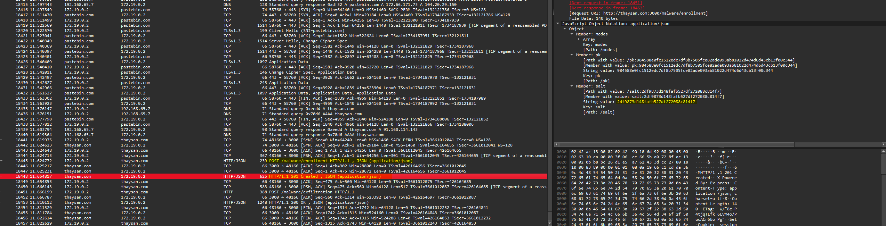
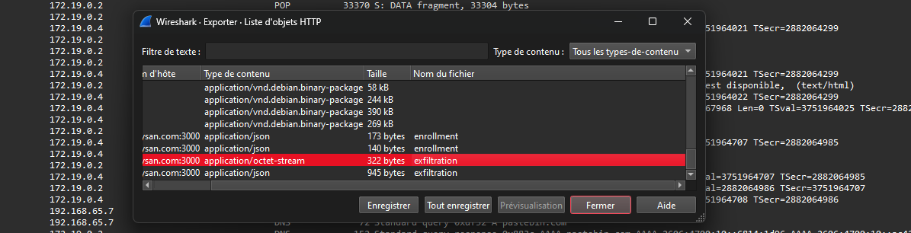
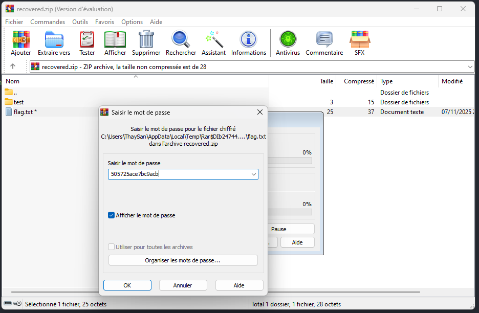

Dans le main.py, on peut voir que le malware utilise un générateur d'aléatoire spécial.
Il est utilisé pour générer la clé privée éphémère et le mot de passe zip 

```python
# [...]

class Malware:
    def __init__(self) -> None:
# [...]
        self.prng = SplitMixRNG()
        self.private_key = b"".join([self.prng.next() for _ in range(4)])
# [...]

    def exfiltration(self):
# [...]
        zip_password = self.prng.next().hex().encode("utf-8")

# [...]
```

Ce genre de PRNG, appelé SplitMix64, est inversible. Autrement dit : à partir d'un output, on peut "remonter" les états précédents et retrouver les générations précédentes.

Un exemple :

```python
from prng import SplitMixRNG

MASK  = (1 << 64) - 1
GAMMA = 0x9E3779B97F4A7C15
C1    = 0xBF58476D1CE4E5B9
C2    = 0x94D049BB133111EB

# inverses mod 2^64 (C1, C2 sont impairs → inversibles)
C1_INV = 0x96DE1B173F119089
C2_INV = 0x319642B2D24D8EC3

def mix(x: int) -> int:
    z = x & MASK
    z ^= (z >> 30); z = (z * C1) & MASK
    z ^= (z >> 27); z = (z * C2) & MASK
    z ^= (z >> 31)
    return z & MASK

def _unxorshift_right(y: int, k: int) -> int:
    # Inverse y = x ^ (x >> k) (reconstruction MSB -> LSB)
    x = 0
    for i in range(64):
        bitpos = 63 - i
        bit = (y >> bitpos) & 1
        sh = bitpos + k
        if sh <= 63:
            bit ^= (x >> sh) & 1
        x |= bit << bitpos
    return x & MASK

def invert_mix(z: int) -> int:
    # Retourne l'état 'state_n' tel que z = mix(state_n)
    y = _unxorshift_right(z, 31)
    y = (y * C2_INV) & MASK
    y = _unxorshift_right(y, 27)
    y = (y * C1_INV) & MASK
    y = _unxorshift_right(y, 30)
    return y & MASK

def rewind_from_output(z_now: bytes, k: int) -> list[bytes]:
    prev = []
    state_n = invert_mix(int.from_bytes(z_now, 'big'))
    for _ in range(k):
        state_n = (state_n - GAMMA) & MASK                   # état précédent
        prev.append(mix(state_n).to_bytes(8, 'big'))         # sortie précédente
    return prev
  

# Test de la prédiction
prng = SplitMixRNG()
randoms = [prng.next() for _ in range(5)]
predicted = rewind_from_output(randoms[-1], 4)
predicted = predicted[::-1]

print(randoms[:4] == predicted)
# True
```

Grâce à la database, on a pu récupérer le mot de passe zip, c'est à dire une sortie du PRNG qui nous permet de reconstruire la clé privée éphémère.

Il nous faut également le salt utilisé dans la génération de la clé de chiffrement. Il est en clair dans la réponse du serveur à /malware/enrollment :



Et enfin, il nous faut le zip chiffré que l'on trouve également dans le pcap :



Une fois la clé privée trouvé, il suffit de suivre les mêmes étapes que le malware pour générer la clé de chiffrement et déchiffrer le zip.

```python
# Test de la prédiction
zip_password = "505725ace7bc9acb"                                     # Le mot de passe zip était la sortie du prng mis en hexa.
private_key = rewind_from_output(bytes.fromhex(zip_password), 4)      # On fait donc l'inverse en repassant l'hexa en bytes
private_key = b''.join(private_key[::-1])

c2_salt = bytes.fromhex("2df9873d148fafb527df272088c814f7")           # Récupéré dans le pcap

c2_public_key = utils.c2_public_key()                                           # Copié-collé du malware
shared_secret = x25519.scalar_mult(private_key, c2_public_key)                  # Copié-collé du malware
zip_password_key = utils.hkdf(shared_secret, c2_salt, b"exfiltration:enc", 32)  # Copié-collé du malware

with open("files.zip.enc", "rb") as f:
  ciphertext = f.read()
zipfile = utils.decrypt(ciphertext, zip_password_key)

with open("recovered.zip", "wb") as f:
  f.write(zipfile)
```

Plus qu'à ouvrir le zip et utiliser le mot de passe trouvé en database :

