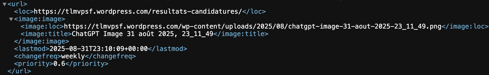
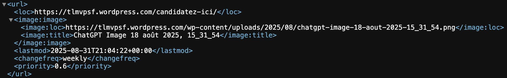
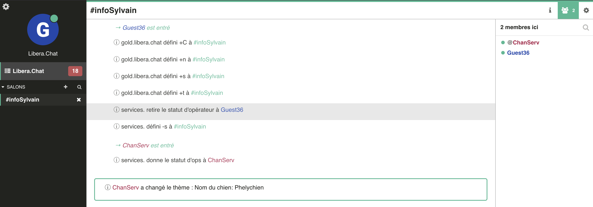
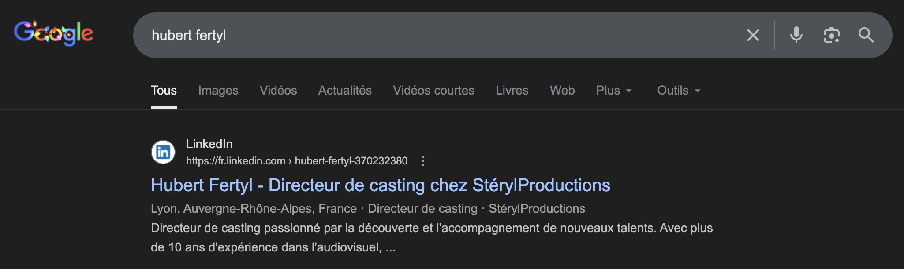
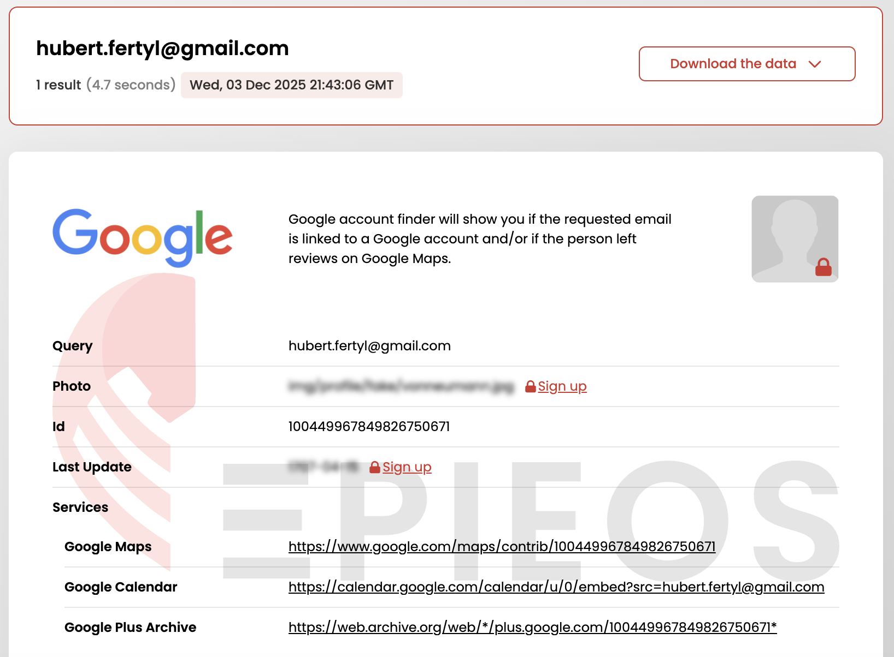
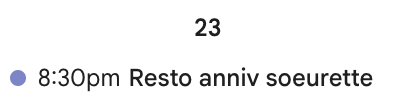
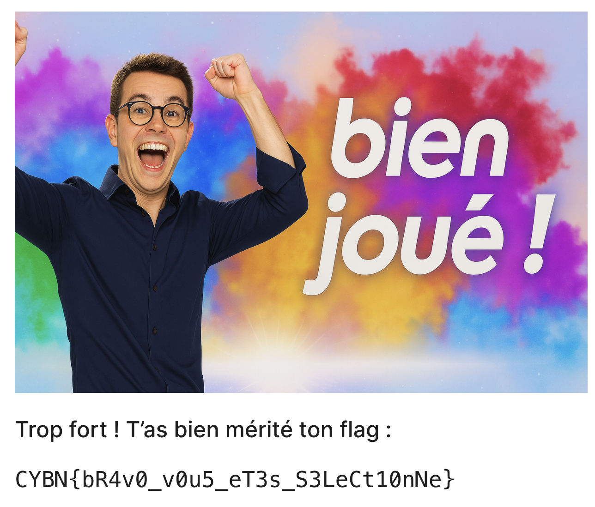

# Casting - Writeup

Alors, ça ne vous donne pas envie d'y participer à ce super nouveau jeu télé ? Bon quoi qu'il en soit il va bien falloir se balader un peu sur cette foutue page de casting.

Bon alors nous avons une page d'accueil avec quelques infos sur le jeu, nous avons également une superbe page sur le présentateur Stéryl Fébaud et toutes ses émissions *(y'en a beaucoup dis donc)*. Mais bon nous on a besoin des résultats de candidature, or quand j'appuie sur "Candidater", le formulaire est fermé !!!

Bon... je vois pas plus de pages que cela en visible, y'a peut être moyen d'en récupérer certaines qui sont cachées ? Regardons alors la sitemap du site en cherchant https://tlmvpsf.wordpress.com/sitemap.xml dans u moteur de recherche, on tombe sur ceci :

Bingo, la page des résultats des candidatures ! Bon ce serait trop facile pour un medium... donc forcément l'accès est bloqué par un mot de passe. Mais lequel ? En regardant bien la sitemap on trouve une autre page cachée :

Tiens tiens, c'est la page des candidatures quand elles sont ouvertes : https://tlmvpsf.wordpress.com/candidatez-ici/
*(Qu'est ce qu'il est mal foutu ce site quand même... Ils se sont pas cassés la tête, hop on cache juste la page et osef)*

Bon regardons un peu, mais que voyons-nous ? Qui est ce magnifique directeur de casting sur la vidéo ?! *(Ne nous égarons pas trop non plus du sujet mais sa beauté est objectivement indéniable)*
En soit la vidéo ne nous apprend pas grand chose mais si on regarde la chaîne YouTube de Hubert Fertyl (le directeur de casting), on trouve une autre vidéo intitulée "test video" : https://youtu.be/-vTU0YYjCZI?si=AZ25Nnogd2NK2263 

Pas sûr qu'il se souvienne avoir publié ça ! Car bon il va quand même donner des infos sur le fameux mot de passe que l'on cherche :
>"C'est la date d'anniv de ma sœur et le nom de mon chien avec un tiret entre les deux"

Ensuite son assistant lui demande le nom du chien, ce à quoi Hubert répond "Je t'envoie l'orthographe sur le chat Libera..." FOUTU BRUIT ON ENTEND PAS LE NOM DU LIBERA !!! *(Quel mauvais timing dis donc...)* Heureusement que les sous-titres sont bien faits et que ces derniers indiquent #infoSylvain.

Ne perdons pas de temps et dirigeons-nous vers https://web.libera.chat/ en mettant #infoSylvain dans Salon. On obtient ceci :

**Phelychien** est le nom du chien !

Maintenant il ne reste plus qu'à trouver la date d'anniversaire de la sœur d'Hubert Fertyl. Cherchons tout simplement son nom sur Google et voilà ce qui sort en premier :

Un profil LinkedIn, tiens tiens... Il travaille chez StérylProductions, ça semble être bien lui. En cliquant sur Coordonnées on obtient son mail : hubert.fertyl@gmail.com (pas le plus original, on aurait pu le trouver à l'aveugle).

Que peut-on déduire de cela ? Allons sur Epieos pour savoir ce qu'il en est :

Vu que l'on cherche une date, pourquoi ne pas aller voir son calendrier ? 

Bingo ! Un resto d'anniversaire pour sa sœur programmé le **23 novembre 2025**. Et qu'est ce qu'il est sympa ce Hubert d'y spécifier aussi "Memo format mdp: DD/MM-..." dans un évènement de son calendrier.

Bon là il n'y a plus de doute, le mot de passe est : `23/11-Phelychien`. En entrant ceci dans notre [page de résultats](https://tlmvpsf.wordpress.com/resultats-candidatures/), on a ce magnifique écran :

On récupère ainsi le flag : **`CYBN{bR4v0_v0u5_eT3s_S3LeCt10nNe}`**