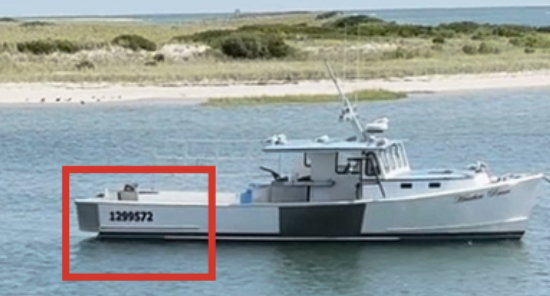
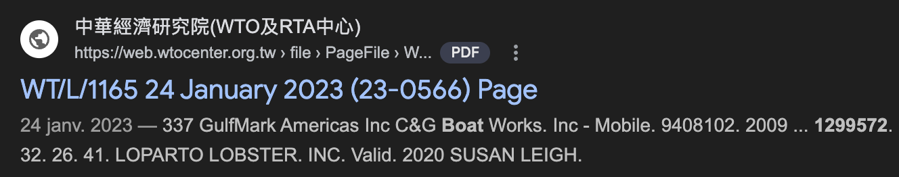
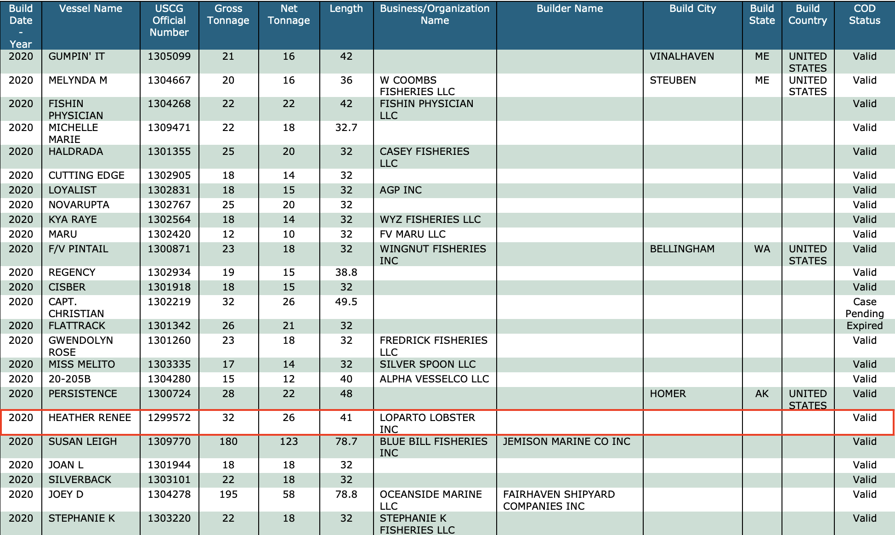
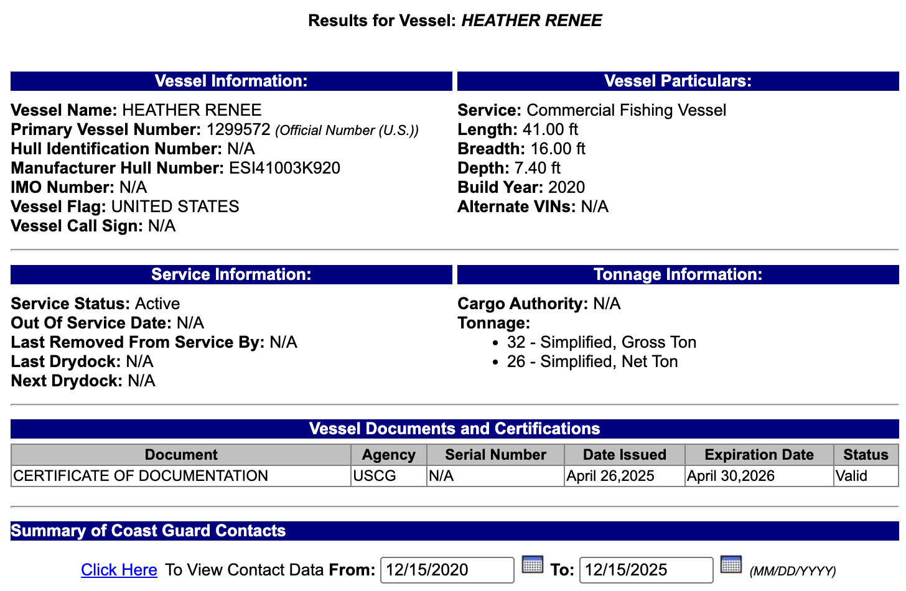
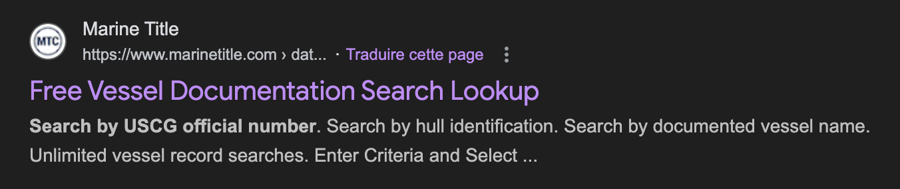
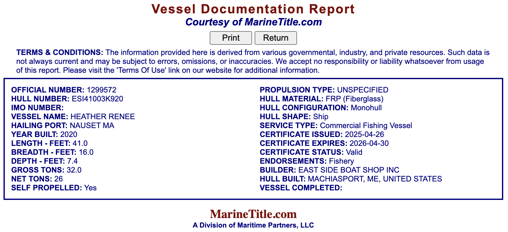
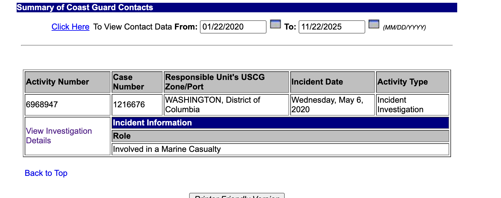
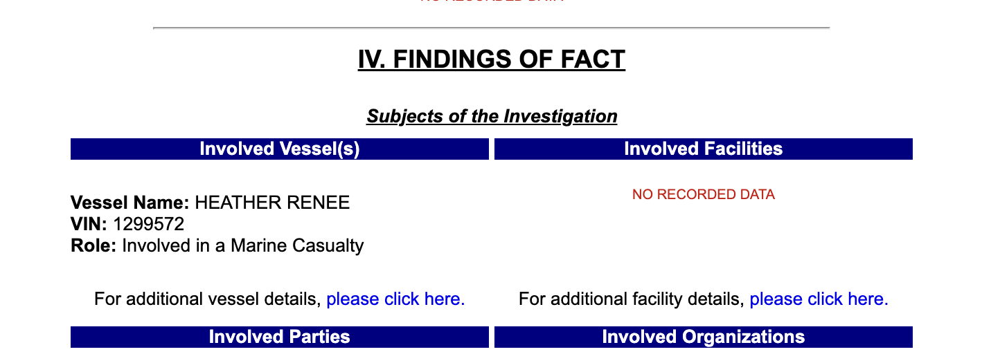
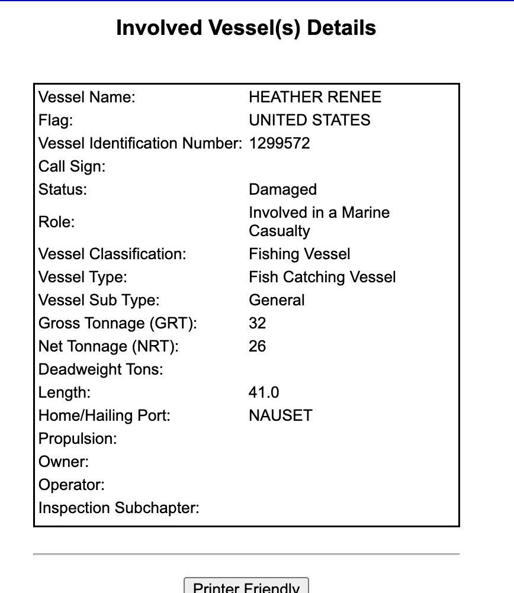

# Globe Trotter [3/3] - Writeup

Ah la la... ce foutu bateau. Je voulais m'excuser par avance, fourbe que je suis. À l'origine c'était plus facile à trouver je vous jure ! Les aléas de l'indexation Google ne s'anticipent pas toujours... 

Bon assez radoté, passons au challenge. Alors on a cette vidéo avec un très joli paysage et surtout des bateaux. Celui qui nous intéresse est le suivant :

Alors cela dépendait vraiment des ordis j'ai l'impression, sur le mien je n'ai pas eu de soucis de résolution et on arrivait à bien lire le numéro sur la coque. Certains ont dû utiliser les effets et filtres de VLC pour y arriver (sorry pour cette déconvenue non anticipée 😅). Enfin bon, on a notre point de départ : **1299572**.

*Mais dis-moi Jamy, c'est quoi ce numéro en fait ?* 🤓
Eh bah t'as qu'à cherche sur Google Fred... Cherchons tout bêtement `1299572 boat` sur notre moteur de recherche préféré Google *(ET PAS SUR ECOSIA HEIN LOLA SINON TU TROUVES DES TRUCS BIZARRES)*, même pas besoin de Google dork (je suis pas un dork fanboy comme Gaël) et on obtient DIRECT ce lien : 

Et en faisant un petit <kbd>Ctrl</kbd> + <kbd>F</kbd> sur le document on tombe sur cette ligne avec notre numéro de coque et plein d'infos ! 

Ledit numéro est désigné comme étant le "USCG Official Number", on y trouve également le nom du bateau (Heather Renee) et surtout on nous donne le nom de l'entreprise propriétaire : **Loparto Lobster**.

Bon... et c'est là que ça devient chiant. Parce que maintenant il faut trouver le port d'attache. Tu as cherché toutes les pistes possbles avec les nouvelles infos récoltées. Alors oui tu as probablement galéré en regardant dans tous les outils, y compris le plus obvious qui est celui de l'USCG (bah ouais ils en parlent dans le document quand même)... eh bah non y'a pas l'info que tu cherches :

En réessayant il y a peu, toutefois, quand on cherche "USCG Official Number finder" sur Google, on tombe sur ceci en 3e résultat :

C'est le bon outil ! Et bizarrement à la période de la CYBN il ne voulait pas sortir sauf en cherchant "primary vessel number hailing port search", c'est pour cela que le challenge a été basculé de Medium à Hard. Bref, en entrant le numéro de la coque, on obtient ceci :

Il est ENFIN LÀ ce foutu port d'attache : **NAUSET MA** (MA pour Massachusetts).

Voilà comment on retrouve ainsi le flag : `CYBN{nauset_loparto-lobster}`.

---
**BONUS** : J'ai été épaté par la solution de Lola, donc je me permets de la partager ici.

On peut trouver toutes les informations juste sur le site USCG sans passer par des recherches Google. Quand on est sur la page avec les informations sur le bateau, on peut cliquer sur "click here" et on voit que rien ne pop up. MAIS si on change la date à debut 2020

On tombe sur une page explicant une sorte d'accident. Si on descend, on tombe sur "involved vessel", ou l'on peut trouver les détails du bateau

Dont le détail que l'on recherche : le port auquel le bateau est rattaché

