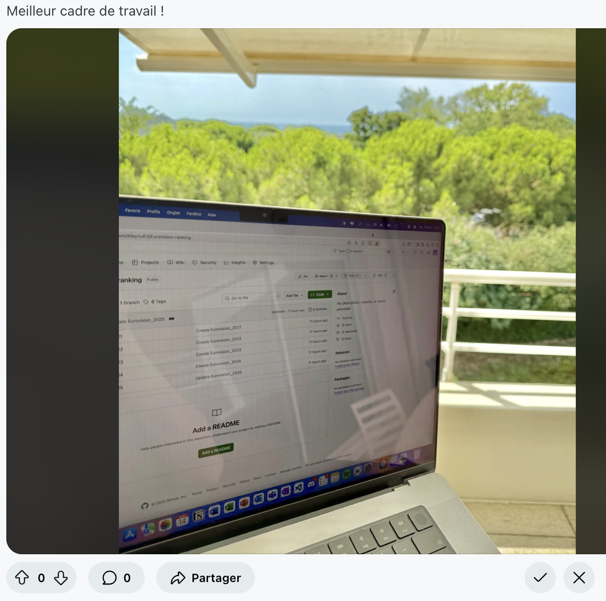
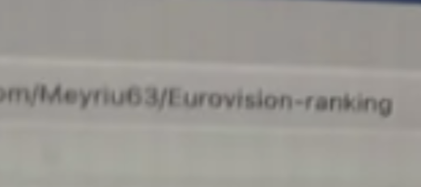
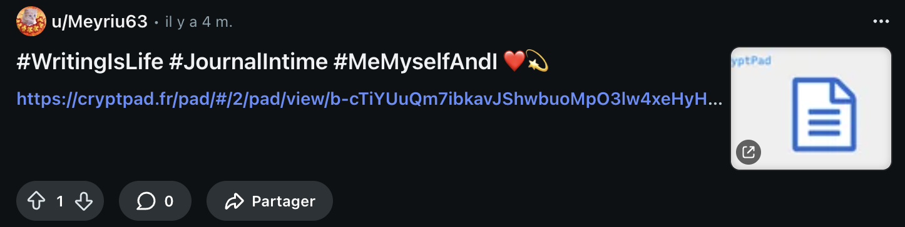
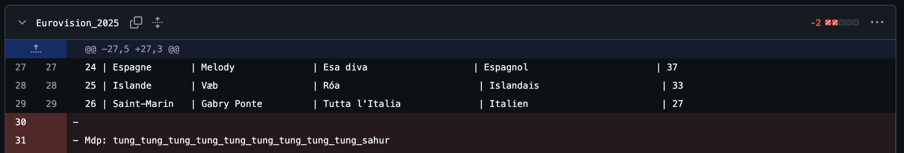
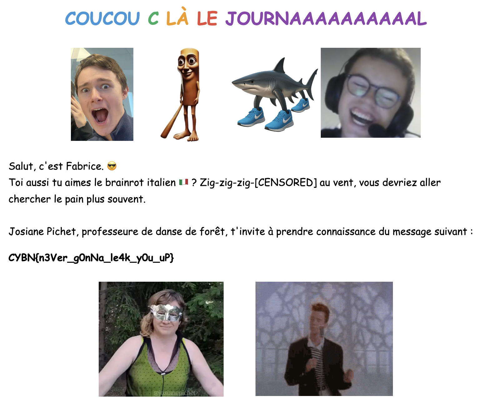
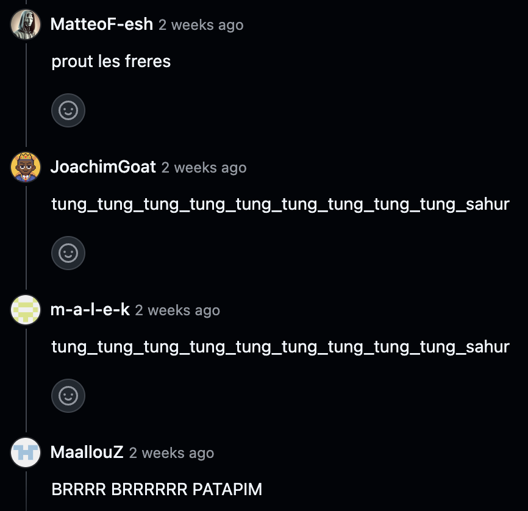

# Secret Story 🤫 - Writeup

Visiblement Meyriu63 passe un bon télétravail dans sa résidence au soleil, mais ça on s'en fiche un peu. Visiblement Meyriu63 adore mettre des emojis littéralement partout, mais ça on s'en fiche aussi un peu. Visiblement Meyriu63 aime bien divulguer sans soucis son travail sur GitHub, et ça pour le coup ça nous intéresse un peu plus.

On voit plusieurs choses dans cette image que l'on nous a fournie :

Le contour fait très clairement penser à l'interface d'un post Reddit, et on voit clairement un lien sur son PC avec un pseudo. 

Le lien mène vers le repo suivant : https://github.com/Meyriu63/Eurovision-ranking

Le pseudo Meyriu63 est donc très probablement aussi son pseudo Reddit.
On tombe ainsi sur son profil : https://www.reddit.com/user/Meyriu63/

Outre l'originale bannière nains de jardins et photo de profil kitsch, on retrouve le post de la photo de départ ainsi qu'un autre post intéressant :

En cliquant sur [ce lien](https://cryptpad.fr/pad/#/2/pad/view/b-cTiYUuQm7ibkavJShwbuoMpO3lw4xeHyHVrkStMJ0/p/), on tombe sur un CryptPad protégé par mot de passe... *(Bah ouais ce serait trop simple sinon)*

Bon... qu'est ce qu'on pourrait explorer pour le trouver ? Regardons de plus près son fameux repo GitHub. En observant le dernier commit on remarque ceci :

Décidément Meyriu63 ne sait PAS GARDER UN MOT DE PASSE EN PRIVÉ. Tant mieux pour nous, on va enfin pouvoir découvrir ses secrets, ses passions, ses émotions...

Oui bon Meyriu63 se fout un peu de notre gueule. Mais au moins il y a le flag que l'on peut copier-coller : **`CYBN{n3Ver_g0nNa_le4k_y0u_uP}`**

*P.S. Nous avons beaucoup apprécié vos mignons petits commentaires sous le commit*

