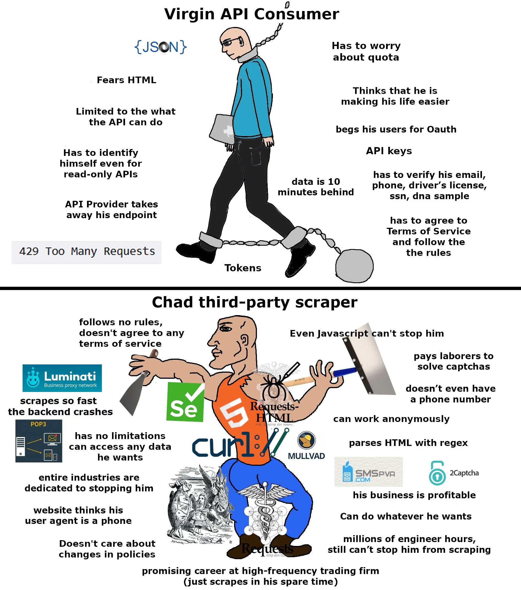

# Il court il court, le furet !

## Philosophie

Là l'objectif était très simple : montrer que dans la vie, il n'y a pas que les APIs pour 
récupérer du contenu sur un site web.

> SI ON VOIT DU CONTENU SUR UNE PAGE, ALORS ON PEUT LE RÉCUPÉRER.

-Bible du scrapper (que je viens d'inventer), page 1, verset 1.

## Résolution

Il suffisait de faire un script pour récupérer l'url affichée, et y accéder en
moins de 0.7 secondes. Je vais pas te faire un dessin c'était pas compliqué 
et ça se CHATGPT très bien. Fallait juste penser à garder les cookies de 
session...

