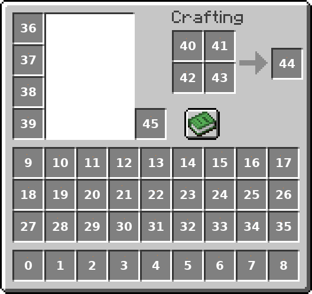

Les panes sont des cases grises avec très peu de pixel de différence par rapport à une case vide : il faut donc automatiser la recherche de ces cases, et retourner les bons index

Indiquer les bons index est la partie chiante : ils sont dans un ordre pénible

Une facon de faire : ouvrir l'image d'aide dans paint, poser un pixel de couleur bien distinguable (orange) avec les pixel RG fixed (ici (255, 130)), et le trosième pixel B avec la valeur de l'index de la case.
Comme ça, avec un script, on peut aisément retrouver la position d'un index, ainsi que sa valeur.

Voici l'image en question :

Le script consiste ensuite à :

- récupérer le premier challenge à l'aide d'une session
- parser la page avec le contenu utile
- chercher les pane avec les couleurs différentes, en se basant sur les positions connues de l'index de debug
- envoyer la liste des panes trouvés
- repeat
- flag

Flag : ``CYBN{C0ngr4tul4t10n_Y0u'r_N0t_4_Hum4n}``