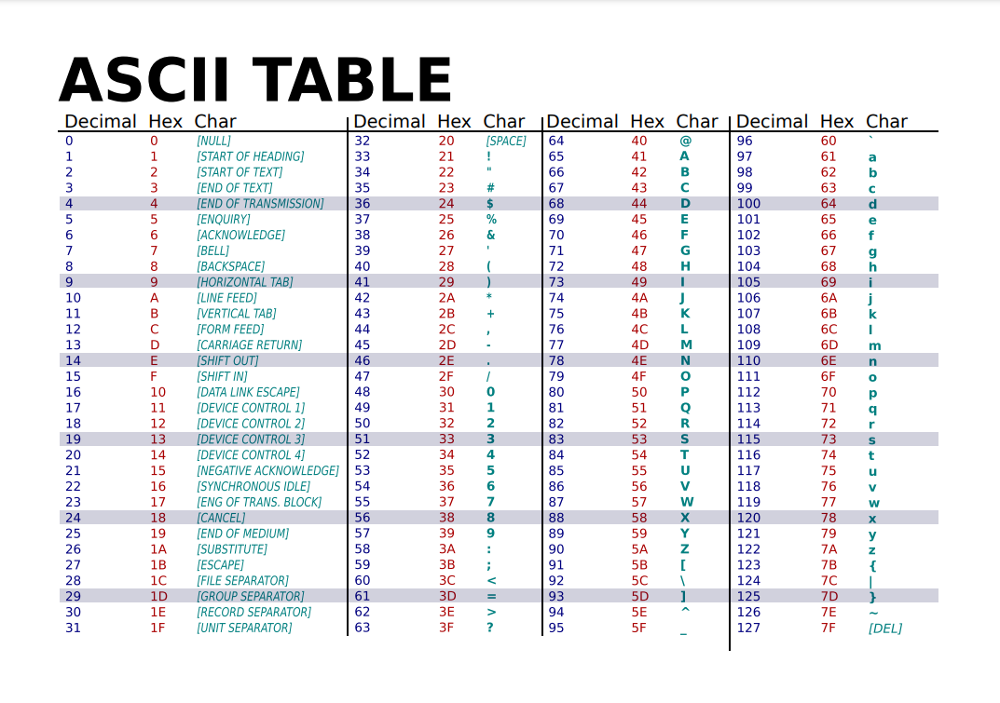

# Le Coffre des Pabètes


## Consigne 

Le pays des Pabètes, le Pabetistan est un incroyable pays, où vivent des petit être simplets mais heureux : les Pabètes. Depuis des siècles ils recherchent leur précieux artefact qui leur renderait leur gloire d'antant, **l'épée de Türing**, leur père à tous.

Malheuereusemnt il leur a été subtilisé lors de la troisième grande guerre par leurs ennemis, les Pakons. Le général Fut-fut chargé de la sécurité extérieur du Pabetistan vous a confié la lourde tâche de le récupérer, pour cela il vous donne des précieuses informations. 

**L'épée de Türing** est cachée dans le grand coffre-automate du palais impérial de la Pakonie, plus connu sous le nom de **SekureMaisPaTro**. Ce coffre est configuré de tel sorte qu'il n'accepte seulement du code provenant du langage universel, le **Brainfuck**.

Pour que **SekureMaisPaTro** s'ouvre il faut que votre code remplisse les conditions suivantes :
 - le code doit contenir seulement les 8 caractèes sacrés
 - le code doit accepter un input et sortir un input
 - l'input est une chaine de caractère aléatoire ente "1" et "9"
 - l'output est une chaine de caratères corespondant au carré de l'entier de l'input

Le général vous glisse aussi une faille à l'oreille, **SekureMaisPaTro** ne peux pas excéder 100 000 commandes, une fois ce montant passé le contenu de la cellule courante est renvoyé de force.

Saurez-vous récupérer l'artefact tant convoité par le Pabetistan ?

## Résolution

Ce défi met en scène l’algorithmie avec ce qu’on appelle les langages Türing-complet, ce sont des langages qui théoriquement pourraient implémenter n’importe quel programme informatique dans leur logique.

Le défi lui s’appuie sur le Brainfuck (BF), créé en 1993 par Urban Müller, il a le mérite d’être “‘simple”, mais en théorie il es possible d’exécuter n’importe quel algorithme.

Il repose sur 8 commandes:

| Symbole | Action |
|----|----|
| > | Déplace le pointeur d’un cran à gauche |
| < | Déplace le pointeur d’un cran à droite |
| + | Incrémente de 1 la valeur de la cellule actuelle |
| - | Décrémente de 1 la valeur de la cellule actuelle |
| . | Affiche le caractère ASCII correspondant à la valeur de la cellule actuelle |
| , | Lit un caractère et le stocke dans la cellule courante |
| \[ | Si la cellule actuelle vaut 0, saute vers le `[` correspondant |
| \] | Si la cellule actuelle ne vaut pas 0, reviens vers le `]` correspondant |

Le programme contient de 30 000 cellules de 0 à 255, soit le tableau ASCII

.

Pour résoudre le défi plusieurs solutions sont possible, soit par calcul pur et simple soit par disjonction des cas (on a un nombre limité et connu d'input et d'output, donc on peux juste faire des cases)

Pour sa résolution je me suis basé sur une méthode hybride :
1. Récupération de l'input, passage en ASCII et initialisation
2. Calcul du carré
3. Netoyage
4. Disjonction des cas pour afficher le string corresondant à l'entier trouvé

Cette méhode à un problème, elle contient une boucle infinie, néanmoins cela est patché par une instruction donnée dans la consigne
> Le général vous glisse aussi une faille à l'oreille, **SekureMaisPaTro** ne peux pas excéder 100 000 commandes, une fois ce montant passé le contenu de la cellule courante est renvoyé de force.

Le code en question :

```
// récupération de l'input et initialisation
,				                   // récupération de l'input I dans la case 0
>+++++++		  	               // on place 7 dans la case 1 pour soustraire de 7 fois 
[<------->-]<+                     // on enleve 7 fois 7 et on ajoute 1 soit 48 pour revenir en valeur numérique
[>+>+>+<<<-]>                      // on duplique I qui devient A B et B'


// déroulement de l'algorithme pour le calcul du carré 
[			                       // tant que A plus grand que 0
->			                       // A moins 1
[<<+>>-]			               // R egal R plus B donc B egal 0
>[>+<-]<                           // on decale B' d'une case à gauche la case 4
>>[<+<+>>-]			               // on duplique B' on a donc B en case 2 et B' en case 3
<<<				                   // on replace le pointeur sur A
]				                   // fin tant que

// on nettoie un peu 
>[-]>[-]<<<					       // on vide toutes le cases sauf le resultat en case 0

// si le carré vaut 1 on affiche 1 en ascii
[>+>+<<-]						   // on duplique le résultat dans les case 1 et 2
+								   // on met l'element comparateur (0) dans la case 0
[>-<-]                             // tant que le comparateur n'est pas vide on enleve 1 à lui est au comparé


>[

// on est dans la boucle si on est pas egal a 1 on test si on est egal a 4
<[-]>[-]>[>+<-]>[<+<+>>-]          // on met les cases 1 et 2 a 0 et on place le resultat en case 3 puis on le duplque en 1 et 2
<<<++++                            // on met le comparateur (4) dans la case 1
[>-<-]							   // tant que le comparateur n'est pas vide on enleve 1 à lui est au comparé

>[

// on est dans la boucle si on est pas egal a 1 ou 4 on test si on est egal a 9
<[-]>[-]>[>+<-]>[<+<+>>-]          // on met les cases 1 et 2 a 0 et on place le resultat en case 3 puis on le duplque en 1 et 2
<<<+++++++++                       // on met le comparateur (9) dans la case 1
[>-<-]							   // tant que le comparateur n'est pas vide on enleve 1 à lui est au comparé

>[

// on est dans la boucle si on est pas egal a 1 ou 4 ou 9 on test si on est egal a 16
<[-]>[-]>[>+<-]>[<+<+>>-]          // on met les cases 1 et 2 a 0 et on place le resultat en case 3 puis on le duplque en 1 et 2
<<<++++++++++++++++                  // on met le comparateur (16) dans la case 1
[>-<-]							   // tant que le comparateur n'est pas vide on enleve 1 à lui est au comparé

>[

// on est dans la boucle si on est pas egal a 1 ou 4 ou 9 ou 16 on test si on est egal a 25
<[-]>[-]>[>+<-]>[<+<+>>-]          // on met les cases 1 et 2 a 0 et on place le resultat en case 3 puis on le duplque en 1 et 2
<<<+++++++++++++++++++++++++                 // on met le comparateur (25) dans la case 1
[>-<-]							   // tant que le comparateur n'est pas vide on enleve 1 à lui est au comparé

>[

// on est dans la boucle si on est pas egal a 1 ou 4 ou 9 ou 16 ou 25 on test si on est egal a 36
<[-]>[-]>[>+<-]>[<+<+>>-]          // on met les cases 1 et 2 a 0 et on place le resultat en case 3 puis on le duplque en 1 et 2
<<<++++++++++++++++++++++++++++++++++++                 // on met le comparateur (36) dans la case 1
[>-<-]							   // tant que le comparateur n'est pas vide on enleve 1 à lui est au comparé

>[

// on est dans la boucle si on est pas egal a 1 ou 4 ou 9 ou 16 ou 25 ou 36 on test si on est egal a 49
<[-]>[-]>[>+<-]>[<+<+>>-]          // on met les cases 1 et 2 a 0 et on place le resultat en case 3 puis on le duplique en 1 et 2
<<<+++++++++++++++++++++++++++++++++++++++++++++++++                 // on met le comparateur (49) dans la case 1
[>-<-]							   // tant que le comparateur n'est pas vide on enleve 1 à lui est au comparé

>[

// on est dans la boucle si on est pas egal a 1 ou 4 ou 9 ou 16 ou 25 ou 36 ou 49 on test si on est egal a 64
<[-]>[-]>[>+<-]>[<+<+>>-]          // on met les cases 1 et 2 a 0 et on place le resultat en case 3 puis on le duplique en 1 et 2
<<<++++++++++++++++++++++++++++++++++++++++++++++++++++++++++++++++                 // on met le comparateur (56) dans la case 1
[>-<-]							   // tant que le comparateur n'est pas vide on enleve 1 à lui est au comparé

>[

// on est dans la boucle si on est pas egal a 1 ou 4 ou 9 ou 16 ou 25 ou 36 ou 49 ou 64 on test si on est egal a 81
<[-]>[-]>[>+<-]>[<+<+>>-]          // on met les cases 1 et 2 a 0 et on place le resultat en case 3 puis on le duplique en 1 et 2
<<<+++++++++++++++++++++++++++++++++++++++++++++++++++++++++++++++++++++++++++++++++                 // on met le comparateur (56) dans la case 1
[>-<-]							   // tant que le comparateur n'est pas vide on enleve 1 à lui est au comparé

>[


]

// si il sort maintenant il vaut 56 donc on affiche 81
>>>++++++++[<+++++++>-]<.            // on affiche 8 en ASCII (56)
-------.                                 // on affiche 1 en ASCII (49)
[-+]                           // on bloque le programme pour qu'il s'arrete ici


]

// si il sort maintenant il vaut 56 donc on affiche 64
>>>+++++++[<+++++++>-]<+++++.          // on affiche 6 en ASCII (54)
--.                                 // on affiche 4 en ASCII (52)
[-+]                           // on bloque le programme pour qu'il s'arrete ici

]

// si il sort maintenant il vaut 49 donc on affiche 49
>>>+++++++[<+++++++>-]<+++.          // on affiche 4 en ASCII (52)
+++++.                               // on affiche 9 en ASCII (57)
[-+]                           // on bloque le programme pour qu'il s'arrete ici


]

// si il sort maintenant il vaut 36 donc on affiche 36
>>>+++++++[<+++++++>-]<++.          // on affiche 3 en ASCII (51)
+++.                               // on affiche 6 en ASCII (54)
[-+]                           // on bloque le programme pour qu'il s'arrete ici


]

// si il sort maintenant il vaut 25 donc on affiche 25
>>>+++++++[<+++++++>-]<+.          // on affiche 2 en ASCII (50)
+++.                               // on affiche 5 en ASCII (53)
[-+]                           // on bloque le programme pour qu'il s'arrete ici


]

// si il sort maintenant il vaut 16 donc on affiche 16
>>>+++++++[<+++++++>-]<.          // on affiche 1 en ASCII (49)
+++++.                            // on affiche 6 en ASCII (54)
[-+]                           // on bloque le programme pour qu'il s'arrete ici

]

// si il sort maintenant il vaut 9 donc on affiche 9
>>>++++++++[<+++++++>-]<+.       // on affiche 9 en ASCII (57)
[-+]                           // on bloque le programme pour qu'il s'arrete ici

]

// si il sort maintenant il vaut 4 donc on affiche 4
>>>+++++++[<+++++++>-]<+++.    // on affiche 4 en ASCII (52)
[-+]                           // on bloque le programme pour qu'il s'arrete ici

]							   // si le comparateur ne vaut pas 0 alors on continue pour le reste

// si il sort maintenant il vaut 1 donc on affiche 1 
>>>+++++++[<+++++++>-]<.          // on affiche 1 en ASCII (49)
[-]<[-]<[-]<[-]                   // on nettoie les autres cases

```

Version pure sans commentaire et donc adaptée au défi :
```
,>+++++++[<------->-]<+[>+>+>+<<<-]>[->[<<+>>-]>[>+<-]<>>[<+<+>>-]<<<]>[-]>[-]<<<[>+>+<<-]+[>-<-]>[<[-]>[-]>[>+<-]>[<+<+>>-]<<<++++[>-<-]>[<[-]>[-]>[>+<-]>[<+<+>>-]<<<+++++++++[>-<-]>[<[-]>[-]>[>+<-]>[<+<+>>-]<<<++++++++++++++++[>-<-]>[<[-]>[-]>[>+<-]>[<+<+>>-]<<<+++++++++++++++++++++++++[>-<-]>[<[-]>[-]>[>+<-]>[<+<+>>-]<<<++++++++++++++++++++++++++++++++++++[>-<-]>[<[-]>[-]>[>+<-]>[<+<+>>-]<<<+++++++++++++++++++++++++++++++++++++++++++++++++[>-<-]>[<[-]>[-]>[>+<-]>[<+<+>>-]<<<++++++++++++++++++++++++++++++++++++++++++++++++++++++++++++++++[>-<-]>[<[-]>[-]>[>+<-]>[<+<+>>-]<<<+++++++++++++++++++++++++++++++++++++++++++++++++++++++++++++++++++++++++++++++++[>-<-]>[]>>>++++++++[<+++++++>-]<.-------.]>>>+++++++[<+++++++>-]<+++++.--.[-+]]>>>+++++++[<+++++++>-]<+++.+++++.[-+]]>>>+++++++[<+++++++>-]<++.+++.[-+]]>>>+++++++[<+++++++>-]<+.+++.[-+]]>>>+++++++[<+++++++>-]<.+++++.[-+]]>>>++++++++[<+++++++>-]<+.[-+]]>>>+++++++[<+++++++>-]<+++.[-+]]>>>+++++++[<+++++++>-]<.[-]<[-]<[-]<[-]
```
