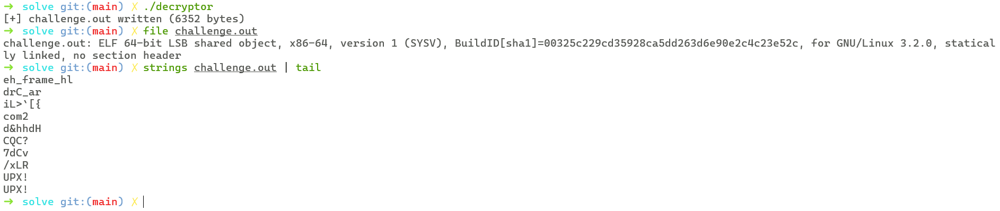

# Challenge Overview

We are given a ZIP archive **BinJutsu.zip** containing:

- `encryptor` — an ELF binary  
- `payload.out` — encrypted data  

Our goal is to **reverse the encryption**, recover the **original binary**, unpack it (UPX), and retrieve the **expected password**.

The encryption performed by `encryptor` consists of:

1. **XOR encryption** (1-byte key)  
2. **RC4 encryption** (4-byte key)  
3. **AES-128 CBC encryption** (16-byte key + 16-byte IV)  
4. Output written to `payload.out`

All cryptographic keys are **generated randomly**… but *deterministically*, because they're created using:

`srand(time(0) + FIXED_CONSTANT)`

And the seed time is the **payload.out file timestamp**.

After recovering the keys and decrypting, the output is a **UPX-packed ELF**, which we unpack to reveal the final password-checking code.

# Solution

## 1. Understanding `encryptor`

### Random Key Generation

When anti-debug (`ptrace`/`sub_18B0`) fails, the program generates:

```c
sub_1908(&v4, 1, 12648430);      // XOR key
sub_1908(v11, 4, 3203339063);    // RC4 key
sub_1908(v12, 16, 3735928559);    // AES key
sub_1908(v13, 16, 305419896);     // AES IV
```

`sub_1908` is:

```c
v6 = time(0);
srand(v6 + a3);
for (i = 0; i < a2; i++)
    buf[i] = rand();
```

This means the encryption keys depend only on:

`time(payload.out creation) + fixed_constant`

### Encryption

The file undergoes:

1) `XOR` / `sub_13C9`

```c
*byte ^= key;
```

2) `RC4` / `sub_1419`

`Standard RC4 KSA + PRGA using a 4-byte key.`

3) `AES-128 CBC encryption` / `sub_168F`

`AES_set_encrypt_key + AES_cbc_encrypt with PKCS#7 padding.`

4) `Output to payload.out` / `sub_1835`

## 2. Reversing

In reverse order, we get:

`AES-CBC → RC4 → XOR`

This requires regenerating all keys exactly the same way:

```c
seed = timestamp + constant
```

We therefore extract the timestamp of payload.out:

```c
stat("payload.out").st_mtime
```

Then regenerate:
- XOR key (1 byte)
- RC4 key (4 bytes)
- AES key (16 bytes)
- AES IV (16 bytes)

The full reversing script is implemented in C:

```c
#include <stdio.h>
#include <stdlib.h>
#include <stdint.h>
#include <string.h>
#include <sys/stat.h>
#include <time.h>
#include <openssl/aes.h>

void xor_decrypt(uint8_t *data, size_t len, uint8_t key) {
    for (size_t i = 0; i < len; i++)
        data[i] ^= key;
}

void rc4(uint8_t *data, size_t len, uint8_t *key, size_t keylen) {
    uint8_t S[256];
    for (int i = 0; i < 256; i++) S[i] = i;
    int j = 0;
    for (int i = 0; i < 256; i++) {
        j = (j + S[i] + key[i % keylen]) & 0xFF;
        uint8_t tmp = S[i]; S[i] = S[j]; S[j] = tmp;
    }

    int i = 0; j = 0;
    for (size_t n = 0; n < len; n++) {
        i = (i + 1) & 0xFF;
        j = (j + S[i]) & 0xFF;
        uint8_t tmp = S[i]; S[i] = S[j]; S[j] = tmp;
        uint8_t K = S[(S[i] + S[j]) & 0xFF];
        data[n] ^= K;
    }
}

void aes_decrypt(uint8_t *in, size_t len, uint8_t *key, uint8_t *iv, uint8_t **out, int *out_len) {
    AES_KEY aes_key;
    AES_set_decrypt_key(key, 128, &aes_key);

    *out = calloc(len, 1);
    memcpy(*out, in, len);

    AES_cbc_encrypt(*out, *out, len, &aes_key, iv, AES_DECRYPT);
    *out_len = len;

    uint8_t pad = (*out)[len - 1];
    if (pad > 0 && pad <= AES_BLOCK_SIZE)
        *out_len = len - pad;
}

void generate_key(uint8_t *buf, size_t len, unsigned int seed) {
    srand(seed);
    for (size_t i = 0; i < len; i++)
        buf[i] = rand() % 256;
}

time_t get_payload_timestamp(const char *filename) {
    struct stat st;
    if (stat(filename, &st) != 0) {
        perror("stat");
        exit(1);
    }
    return st.st_mtime;
}

int main() {
    const char *payload_file = "payload.out";
    FILE *f = fopen(payload_file, "rb");
    if (!f) {
        perror("fopen");
        return 1;
    }

    fseek(f, 0, SEEK_END);
    size_t len = ftell(f);
    fseek(f, 0, SEEK_SET);

    uint8_t *encrypted = malloc(len);
    if (!encrypted) {
        perror("malloc");
        fclose(f);
        return 1;
    }
    fread(encrypted, 1, len, f);
    fclose(f);

    time_t ts = get_payload_timestamp(payload_file);

    uint8_t xor_key;
    uint8_t rc4_key[4];
    uint8_t aes_key[16];
    uint8_t aes_iv[16];

    generate_key(&xor_key, 1, 0xC0FFEE + ts);
    generate_key(rc4_key, sizeof(rc4_key), 0xBEEF1337 + ts);
    generate_key(aes_key, sizeof(aes_key), 0xDEADBEEF + ts);
    generate_key(aes_iv, sizeof(aes_iv), 0x12345678 + ts);

    uint8_t *aes_out = NULL;
    int aes_len = 0;
    aes_decrypt(encrypted, len, aes_key, aes_iv, &aes_out, &aes_len);

    rc4(aes_out, aes_len, rc4_key, sizeof(rc4_key));
    xor_decrypt(aes_out, aes_len, xor_key);

    FILE *out = fopen("challenge.out", "wb");
    if (!out) {
        perror("fopen");
        free(encrypted);
        free(aes_out);
        return 1;
    }
    fwrite(aes_out, 1, aes_len, out);
    fclose(out);

    printf("[+] challenge.out written (%d bytes)\n", aes_len);

    free(encrypted);
    free(aes_out);
    return 0;
}
```

After decryption, we get:



This file is an ELF binary, but **compressed** via UPX.

## 3. Unpacking the binary

We run:

`upx -d challenge.out -o chall`

The unpacked binary contains the final password verification:

```c
printf("Enter password: ");
fgets(s, 128, stdin);

if (strlen(s) == 33) {
    for (i = 0; i < 0x21; i++)
        s2[i] = byte_2020[i] ^ 0x42;

    if (!memcmp(s, s2, 0x21))
        puts("OK");
    else
        puts("NOPE");
}
```

The password is simply:

`byte_2020 XOR 0x42`

## 4. Final Decryption Script

```python
encrypted_password = [
    0x01, 0x1B, 0x00, 0x0C, 0x39, 0x75, 0x2A, 0x76,
    0x36, 0x1D, 0x15, 0x76, 0x31, 0x1D, 0x11, 0x72,
    0x0F, 0x71, 0x1D, 0x21, 0x72, 0x72, 0x2E, 0x1D,
    0x00, 0x73, 0x2C, 0x08, 0x37, 0x75, 0x11, 0x37,
    0x3F
]

XOR_KEY = 0x42

decrypted = ''.join(chr(b ^ XOR_KEY) for b in encrypted_password)

print(f"Decrypted password: {decrypted}")
```

