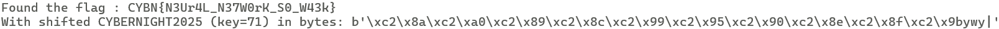
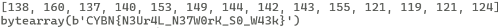

# Challenge Overview

We are given a ZIP archive containing:

- `check` — an ELF binary  
- `flag.txt` — encrypted flag data

Running the binary asks for 32 floating-point numbers, runs them through a neural network, transforms a string using a Caesar-style shift, and then XOR-decrypts `flag.txt`.

## Static Analysis

Opening the binary in IDA, we inspect `main`:

```c
int __fastcall main(int argc, const char **argv, const char **envp)
{
  double v4; // xmm1_8
  int i; // [rsp+0h] [rbp-1D0h]
  unsigned int j; // [rsp+4h] [rbp-1CCh]
  int v7; // [rsp+Ch] [rbp-1C4h]
  FILE *stream; // [rsp+10h] [rbp-1C0h]
  _QWORD v9[32]; // [rsp+20h] [rbp-1B0h] BYREF
  char s[15]; // [rsp+121h] [rbp-AFh] BYREF
  char s1[136]; // [rsp+130h] [rbp-A0h] BYREF
  unsigned __int64 v12; // [rsp+1B8h] [rbp-18h]

  v12 = __readfsqword(0x28u);
  stream = fopen("flag.txt", "rb");
  if ( stream )
  {
    puts("Enter 32 numbers:");
    for ( i = 0; i <= 31; ++i )
    {
      if ( (unsigned int)__isoc99_scanf("%lf", &v9[i]) != 1 )
      {
        puts("Invalid input.");
        return 1;
      }
    }
    v4 = neural_network(v9);
    strcpy(s, "CYBERNIGHT2025");
    caesar_shift(s, (unsigned int)(int)(100.0 * v4));
    for ( j = 0; ; ++j )
    {
      v7 = fgetc(stream);
      if ( v7 == -1 || j > 0x7E )
        break;
      s1[j] = s[(int)j % strlen(s)] ^ v7;
    }
    s1[j] = 0;
    fclose(stream);
    if ( !strncmp(s1, "CYBN{", 5u) )
      printf("Flag: %s\n", s1);
    else
      puts("Incorrect input. ACCESS DENIED.");
    return 0;
  }
  else
  {
    puts("Missing flag.txt file");
    return 1;
  }
}
```

The program:

- Reads 32 doubles from the user
- Passes them to a neural network
- The output determines how much "CYBERNIGHT2025" is Caesar-shifted
- The shifted key is used as a repeating XOR stream to decrypt flag.txt

## Neural Network Insight

The neural network:

```c
unsigned __int64 __fastcall neural_network(__int64 a1)
{
  int i; // [rsp+1Ch] [rbp-44h]
  int j; // [rsp+20h] [rbp-40h]
  int k; // [rsp+24h] [rbp-3Ch]
  double v5; // [rsp+28h] [rbp-38h]
  double v6[5]; // [rsp+30h] [rbp-30h]
  unsigned __int64 v7; // [rsp+58h] [rbp-8h]

  v7 = __readfsqword(0x28u);
  for ( i = 0; i <= 3; ++i )
  {
    v6[i] = *(double *)&bias_hidden[i];
    for ( j = 0; j <= 31; ++j )
      v6[i] = weights_hidden[4 * j + i] * *(double *)(8LL * j + a1) + v6[i];
    v6[i] = sigmoid(v6[i]);
  }
  v5 = 0.2;
  for ( k = 0; k <= 3; ++k )
    v5 = weights_output[k] * v6[k] + v5;
  sigmoid(v5);
  return v7 - __readfsqword(0x28u);
}
```

returns a value in the (0, 1) range. After being multiplied by 100 and cast to int, this gives a key between:

`0 < key ≤ 100`

This means that instead of reverse-engineering neural weights, we can brute force the Caesar shift value.

# Solution

## Brute-Forcing the Shift

We attempt all possible Caesar shift values (`0` to `100`), generate the shifted `CYBERNIGHT2025`, and use it as a XOR key to decrypt the flag:

```python
def caesar_shift(s, key):
    return ''.join([chr(ord(c) + key) for c in s])

with open("flag.txt", "rb") as f:
    for key in range(101):
        cybernight = "CYBERNIGHT2025"
        shifted_cybernight = caesar_shift(cybernight, key)

        decrypted = []
        i = 0
        while (ch := f.read(1)):
            decrypted.append(chr(ch[0] ^ ord(shifted_cybernight[i % len(shifted_cybernight)])))
            i += 1
        
        decrypted_str = ''.join(decrypted)

        if decrypted_str.startswith("CYBN{"):
            print(f"Found the flag : {decrypted_str}")
            print(f"With shifted CYBERNIGHT2025 (key={key}) in bytes: {shifted_cybernight.encode()}")
            break
        
        f.seek(0)
```

When the plaintext begins with `CYBN{`, we have recovered the valid flag.



## Alternative — Known Plaintext Attack

Since the decrypted flag always begins with `C`, we can compute the rotation directly:

```python
with open("flag.txt", "rb") as file:
    flag_bytes = file.read()

rotation_char = chr(flag_bytes[0] ^ ord("C"))
rotation_offset = ord(rotation_char) - ord("C")

encryption_key = "CYBERNIGHT2025"

shifted_key_values = [ord(char) + rotation_offset for char in encryption_key]
print(shifted_key_values)

result = bytearray()
for i in range(len(flag_bytes)):
    key_value = shifted_key_values[i % len(shifted_key_values)]
    result.append(flag_bytes[i] ^ key_value)

print(result)
```

