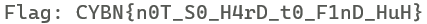
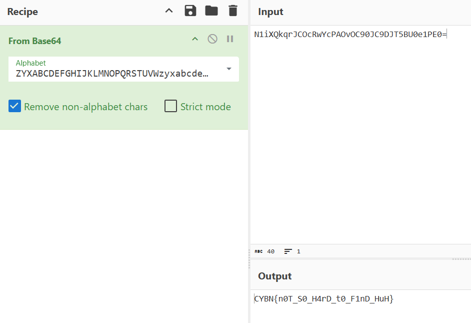

# Challenge Overview

We are given a binary named `offbase`. Running the binary with an argument checks whether the Base64 encoding of our input matches a hidden encoded value stored in the program. If it matches, the program prints `Yay`, otherwise `Nay`.

# Solution

To recover the expected input, we reverse the binary.


## Static Analysis

Opening the binary in IDA, we inspect `main`:

```c
int __fastcall main(int argc, const char **argv, const char **envp)
{
    size_t v3;
    _QWORD v5[10];
    char s2[128];
    char s1[264];

    v5[0] = "N1iX";
    v5[1] = "Qkqr";
    v5[2] = "JCOc";
    v5[3] = "RwYc";
    v5[4] = "PAOv";
    v5[5] = "OC90";
    v5[6] = "JC9D";
    v5[7] = "JT5B";
    v5[8] = "U0e1";
    v5[9] = "PE0=";

    join_chunks(s2, v5, 10);

    if (argc != 2)
        return 0;

    v3 = strlen(argv[1]);
    base64_encode(argv[1], v3, s1);

    if (!strcmp(s1, s2))
        puts("Yay");
    else
        puts("Nay");

    return 0;
}
```
So the program:

- Holds 10 Base64 chunks in `v5`
- Joins them into a single encoded string `s2`
- Base64-encodes our input using a custom alphabet
- Compares the result with `s2`

Our job is to decode the custom Base64 to obtain the expected input.

Inside the disassembled `base64_encode` function, we see the alphabet:

`ZYXABCDEFGHIJKLMNOPQRSTUVWzyxabcdefghijklmnopqrstuvw0123456789-_`

This is similar to Base64 but scrambled. Normal Base64 uses:

`ABCDEFGHIJKLMNOPQRSTUVWXYZabcdefghijklmnopqrstuvwxyz0123456789+/`


So we need to translate from the custom alphabet into the standard Base64 before decoding.

```python
import base64

CUSTOM_B64 = "ZYXABCDEFGHIJKLMNOPQRSTUVWzyxabcdefghijklmnopqrstuvw0123456789-_"

STANDARD_B64 = "ABCDEFGHIJKLMNOPQRSTUVWXYZabcdefghijklmnopqrstuvwxyz0123456789+/"

TRANS_TABLE = str.maketrans(CUSTOM_B64, STANDARD_B64)

def custom_b64_decode(s: str) -> bytes:
    std_b64 = s.translate(TRANS_TABLE)
    return base64.b64decode(std_b64)

if __name__ == "__main__":
    chunks = [
        "N1iX", "Qkqr", "JCOc", "RwYc",
        "PAOv", "OC90", "JC9D", "JT5B",
        "U0e1", "PE0="
    ]
    encoded = "".join(chunks)

    decoded = custom_b64_decode(encoded)
    print("Flag:", decoded.decode())
```



## Alternative Solve (CyberChef)

This challenge can also be solved in CyberChef (make sure to escape the `-` character in the alphabet by surrounding it with `/`):



