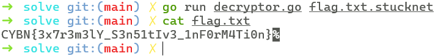

# Challenge Overview

We are given a ZIP archive **Stucknet.zip** (password: `infected`) containing:

- `stucknet.exe` — malware-like encryptor  
- `flag.txt.stucknet` — encrypted flag  
- `frag1.bin` + `frag2.bin` — key fragments written by the malware  

The binary is packed with **MPRESS 2.19**, and must be unpacked before static analysis.  
Its purpose is to:

1. Generate encryption keys
2. Encrypt files in a specific directory (`C:\Users:\Public\OmegaIndustrialApp\data\`)
3. Save key fragments (`frag1.bin` & `frag2.bin`) to `%APPDATA%/Roaming`
4. Encrypt each file using **XOR variants → AES-CTR → Base64**
5. Append `.stucknet` extension

We must reverse all of this and recover the original `flag.txt`.


# Solution

## 1. Unpacking the Binary

`stucknet.exe` is MPRESS-packed (can be detected with Detect-It-Easy). Using the [common unpacking procedure:](https://reverseengineering.stackexchange.com/questions/30545/how-do-i-unpack-a-file-protected-by-mpress)

1. Breakpoint at PE entry.
2. Step a few instructions, set hardware breakpoint on `ESP`.
3. Run until unpacking stub reaches OEP.
4. Use **Scylla** to dump & fix the import table.

This yields:

`stucknet_dump_SCY.exe`

Now we can load it in IDA.

## 2. Static Analysis

The unpacked binary is a **Go executable**.  
We inspect `main.main()` and the functions within:

```c
// main.main
void __fastcall main_main()
{
  __int64 v0; // rax
  unsigned __int128 v1; // kr00_16
  unsigned __int128 v2; // kr28_16
  unsigned __int64 v3; // rax
  unsigned __int64 v4; // rbx
  unsigned __int64 v5; // rbx
  unsigned __int64 v6; // [rsp+0h] [rbp-58h]
  __int64 v7; // [rsp+8h] [rbp-50h]
  __int64 v8; // [rsp+18h] [rbp-40h]
  _QWORD v9[7]; // [rsp+20h] [rbp-38h] BYREF

  main_antiDebugSuite();
  v8 = runtime_makeslice(&RTYPE_uint8, 32, 32);
  v0 = crypto_rand_Read(v8, 32, 32);
  v1 = (unsigned __int128)time_Now(v0);
  v3 = v1;
  v4 = *((_QWORD *)&v1 + 1);
  if ( (v1 & 0x8000000000000000LL) != 0LL )
  {
    v3 = (unsigned __int64)(2 * v1) >> 31;
    v4 = v3 + 0xDD7B17F80LL;
  }
  v6 = v4;
  v2 = (unsigned __int128)time_Now(v3);
  v5 = *((_QWORD *)&v2 + 1);
  if ( (v2 & 0x8000000000000000LL) != 0LL )
    v5 = ((unsigned __int64)(2 * v2) >> 31) + 0xDD7B17F80LL;
  v7 = v5
     - 3
     * (((__int64)(v5
                 + ((unsigned __int128)((__int64)(v5 - 0xE7791F700LL) * (__int128)(__int64)0xAAAAAAAAAAAAAAABLL) >> 64)
                 - 0xE7791F700LL) >> 1)
      - ((__int64)(v5 - 0xE7791F700LL) >> 63))
     - 0xE7791F700LL;
  v9[0] = main_main_encryptDirectory_func1;
  v9[2] = 32;
  v9[3] = 32;
  v9[1] = v8;
  v9[4] = (unsigned __int8)v6;
  v9[5] = v7;
  path_filepath_Walk(byte_4DFED7, 40, v9);
  main_saveFragments(
    v8,
    32,
    32,
    v6
  - ((v6 + ((unsigned __int64)((__int64)(v6 - 0xE7791F700LL) >> 63) >> 56) - 0xE7791F700LL) & 0xFFFFFFFFFFFFFF00LL)
  - 0xE7791F700LL,
    v7);
}

// main.antiDebugSuite
char main_antiDebugSuite()
{
  char result; // al
  __int64 i; // rax
  bool isDebuggerPresent; // [rsp+1h] [rbp-11h]
  __int64 v3; // [rsp+2h] [rbp-10h]

  isDebuggerPresent = main_isDebuggerPresent();
  result = main_checkTimeDelta(1500000000);
  if ( result || isDebuggerPresent )
  {
    for ( i = 0; i < 3; i = v3 + 1 )
    {
      v3 = i;
      time_Sleep(1000000000);
    }
    return main_brokenCodePath();
  }
  return result;
}

// main.checkTimeDelta
bool __golang main_checkTimeDelta(__int64 a1)
{
  retval_48B720 v3; // 0:kr00_24.24

  v3 = time_Now(a1);
  time_Sleep(1000000000);
  return time_Since(v3._r0, v3._r1, v3._r2) > a1;
}

// main.main.encryptDirectory.func1
retval_49CE40 __golang main_main_encryptDirectory_func1(__int64 a1, __int64 a2, __int64 a3, __int64 a4, __int64 a5)
{
  __int64 v5; // rdx
  __int64 v6; // r8
  __int64 v7; // r9
  __int64 v8; // r10
  __int64 v9; // r11
  unsigned __int8 v10; // dl
  unsigned __int8 v13; // [rsp+1h] [rbp-29h]
  __int64 v14; // [rsp+2h] [rbp-28h]
  __int64 v15; // [rsp+Ah] [rbp-20h]
  __int64 v16; // [rsp+12h] [rbp-18h]
  __int64 v17; // [rsp+1Ah] [rbp-10h]
  retval_49CE40 result; // 0:rax.8,8:rbx.8

  v6 = *(_QWORD *)(v5 + 40);
  v7 = *(_QWORD *)(v5 + 8);
  v8 = *(_QWORD *)(v5 + 16);
  v9 = *(_QWORD *)(v5 + 24);
  v10 = *(_BYTE *)(v5 + 32);
  if ( !a5 )
  {
    v13 = v10;
    v14 = v6;
    v17 = v7;
    v15 = v8;
    v16 = v9;
    if ( !(*(unsigned __int8 (__golang **)(__int64))(a3 + 24))(a4) )
      main_encryptFile(a1, a2, v17, v15, v16, v13, v14);
  }
  result._r0 = 0;
  result._r1 = 0;
  return result;
}

// main.encryptFile
retval_49C5C0 __golang main_encryptFile(
        __int64 a1,
        __int64 a2,
        __int64 a3,
        __int64 a4,
        __int64 a5,
        unsigned __int8 a6,
        __int64 a7)
{
  __int64 v7; // rax
  __int64 v8; // rdx
  __int64 k; // rbx
  __int64 i; // rbx
  __int64 j; // rbx
  __int64 v14; // rax
  __int64 v15; // rcx
  __int64 v16; // rbx
  __int64 v17; // rdi
  __int64 v18; // rsi
  retval_499A00 v19; // kr40_16
  retval_4507A0 v20; // kr50_16
  __int64 v21; // [rsp+20h] [rbp+8h]
  __int64 v22; // [rsp+28h] [rbp+10h]
  retval_450CE0 v28; // 0:kr20_24.24
  retval_495860 File; // 0:kr00_32.32
  retval_49C5C0 result; // 0:rax.8,8:rbx.8

  v22 = a2;
  v21 = a1;
  if ( a2 >= 9 )
  {
    if ( (unsigned __int8)runtime_memequal(a2 + a1 - 9, byte_4D87E1, 9) )
    {
      result._r0 = 0;
      result._r1 = 0;
      return result;
    }
    a1 = v21;
    a2 = v22;
  }
  File = os_ReadFile(a1, a2);
  if ( File._r3 )
  {
    result._r0 = 0;
    result._r1 = 0;
  }
  else
  {
    v7 = runtime_makeslice(&RTYPE_uint8, File._r1, File._r1);
    v8 = a7;
    if ( a7 )
    {
      if ( a7 == 1 )
      {
        v8 = a6;
        for ( i = 0; File._r1 > i; ++i )
        {
          *(_BYTE *)(v7 + i) = *(_BYTE *)(i + File._r0)
                             ^ (a6
                              + i
                              + ((__int64)(i + ((unsigned __int128)(i * (__int128)(__int64)0x8080808080808081LL) >> 64)) >> 7));
          v8 = a6;
        }
      }
      else if ( a7 == 2 )
      {
        v8 = a6;
        for ( j = 0; File._r1 > j; ++j )
        {
          *(_BYTE *)(v7 + j) = a6
                             ^ *(_BYTE *)(j + File._r0)
                             ^ (j - 7 * ((__int64)((unsigned __int128)(j * (__int128)0x4924924924924925LL) >> 64) >> 1));
          v8 = a6;
        }
      }
    }
    else
    {
      v8 = a6;
      for ( k = 0; File._r1 > k; ++k )
        *(_BYTE *)(v7 + k) = a6 ^ *(_BYTE *)(File._r0 + k);
    }
    v14 = main_encryptAES_CTR(a3, a4, v8, File._r1, a5, (__int64 *)off_5953D0);
    if ( v17 )
    {
      result._r0 = v17;
      result._r1 = v18;
    }
    else
    {
      v19 = encoding_base64__ptr_Encoding_EncodeToString(qword_59C840, v14, v16, v15);
      v28 = runtime_stringtoslicebyte(0, v19._r0, v19._r1);
      result._r0 = os_WriteFile(v21, v22, v28._r0, v28._r1, v28._r2, 420);
      if ( !result._r0 )
      {
        v20 = runtime_concatstring2(0, v21, v22, byte_4D87E1, 9);
        result._r0 = os_rename(v21, v22, v20._r0, v20._r1);
        if ( !result._r0 )
        {
          result._r0 = 0;
          result._r1 = 0;
        }
      }
    }
  }
  return result;
}

// main.saveFragments
__int64 __golang main_saveFragments(__int64 a1, unsigned __int64 a2, unsigned __int64 a3, char a4, char a5)
{
  unsigned __int64 r1; // rbx
  unsigned __int64 r2; // r8
  __int64 r0; // rdx
  retval_49A200 v8; // kr20_16
  retval_49A200 v9; // kr30_16
  unsigned __int64 v11; // [rsp+0h] [rbp-60h]
  unsigned __int64 v12; // [rsp+8h] [rbp-58h]
  __int64 v13; // [rsp+10h] [rbp-50h]
  __int128 v14; // [rsp+18h] [rbp-48h] BYREF
  char *v15; // [rsp+28h] [rbp-38h]
  __int64 v16; // [rsp+30h] [rbp-30h]
  __int128 v17; // [rsp+38h] [rbp-28h] BYREF
  __int16 *v18; // [rsp+48h] [rbp-18h]
  __int64 v19; // [rsp+50h] [rbp-10h]
  char v22; // [rsp+80h] [rbp+20h]
  char v23; // [rsp+88h] [rbp+28h]
  retval_467E80 v24; // 0:kr00_24.24

  if ( a3 < 0x10 )
    runtime_panicSliceAcap(a1, a2, 16);
  if ( a2 < 0x10 )
    runtime_panicSliceB(16, a2, a2);
  r1 = a2 - 14;
  r2 = a3 - 16;
  r0 = a1 + (((__int64)(16 - a3) >> 63) & 0x10);
  if ( r1 > a3 - 16 )
  {
    v22 = a4;
    v23 = a5;
    v24 = runtime_growslice(a1 + (((__int64)(16 - a3) >> 63) & 0x10uLL), r1, a3 - 16, 2, &RTYPE_uint8);
    r1 = v24._r1;
    a5 = v23;
    a4 = v22;
    r0 = v24._r0;
    r2 = v24._r2;
  }
  v13 = r0;
  v11 = r1;
  v12 = r2;
  *(_BYTE *)(r1 + r0 - 2) = a4;
  *(_BYTE *)(r1 + r0 - 1) = a5;
  v17 = xmmword_59CB10;
  v19 = 9;
  v18 = word_4D87EA;
  v8 = path_filepath_join(&v17, 2, 2);
  os_WriteFile(v8._r0, v8._r1, a1, 16, a3, 420);
  v14 = xmmword_59CB10;
  v16 = 9;
  v15 = byte_4D87F3;
  v9 = path_filepath_join(&v14, 2, 2);
  return os_WriteFile(v9._r0, v9._r1, v13, v11, v12, 420);
}
```

### Key Observations

- Anti-debug routines (`main_antiDebugSuite`)
- Keys produced via:
  ```c
  crypto_rand_Read(...)    // 32-byte random buffer
  time_Now()               // timestamp-based values
  ```

- All encryption is done inside main_encryptFile()
- XOR preprocessing uses three different variants depending on a mode value
- AES is used in CTR mode
- Final data is Base64-encoded and written with .stucknet extension
- Two files (frag1.bin, frag2.bin) store:
    - AES key
    - XOR key
    - XOR variant (0, 1, or 2)

### Encryption Overview

Inside `main_encryptFile()` the malware performs the following steps:

1. **Read file contents**
2. **Apply XOR preprocessing**, depending on the selected variant:

    **Variant 0:**  
    `byte ^ key`   
    
    **Variant 1:**
    `byte ^ (key + i + ((i + highbits) >> 7))` 

    **Variant 2:**
    `byte ^ key ^ (i mod 7)`


3. **AES-CTR encryption**, using:
- **AES key** constructed from fragments
- **Hardcoded IV** (recovered during debugging)

4. **Base64-encode** the AES output
5. **Rename file** to add the `.stucknet` extension

### Key Fragment Storage

`main_saveFragments()` writes the key data into two files:

- **frag1.bin** → first 16 bytes of AES key  
- **frag2.bin** → next 16 bytes + XOR key + XOR variant

Since we already possess both fragments, we can reconstruct the full key.

### 3. Understanding the Decryption Logic

To reverse the encryption applied by `main_encryptFile()`, we follow these steps:

#### **Step 1 — Load key fragments**

`AES key = frag1.bin (16 bytes) + frag2.bin[0:16]`
`XOR key = frag2.bin[16]`
`Variant = frag2.bin[17]`


#### **Step 2 — Decode Base64**

`encryptedData = base64.StdEncoding.DecodeString(b64Data)`


#### **Step 3 — AES-CTR decrypt**

Use:
- The **32-byte AES key**
- The **hardcoded 16-byte IV** recovered in the debugger

#### **Step 4 — Undo XOR preprocessing**

Depending on the XOR variant:

**Variant 0:**  
`b = enc[i] ^ key`   

**Variant 1:**
`b = enc[i] ^ (key + (i % 255)) // equivalent to byte ^ (key + i + ((i + highbits) >> 7)) in this case` 

**Variant 2:**
`b = enc[i] ^ key ^ (i % 7)`

The result is the **original plaintext data (flag.txt)**.


### 4. Final Decryptor Code

The decryptor performs the full reverse process (load fragments, AES-CTR decrypt, undo XOR, output original file):

```go
package main

import (
	"crypto/aes"
	"crypto/cipher"
	"encoding/base64"
	"io/ioutil"
	"os"
	"strings"
)

var hardcodedIV = []byte{
	0x4a, 0x78, 0x13, 0x2f, 0xaa, 0xbb, 0x7c, 0x00,
	0x19, 0x88, 0x39, 0x4f, 0xff, 0xcc, 0x11, 0x09,
}

func xorVariants(data []byte, key byte, variant int) []byte {
	output := make([]byte, len(data))
	switch variant {
	case 0:
		for i := range data {
			output[i] = data[i] ^ key
		}
	case 1:
		for i := range data {
			output[i] = data[i] ^ (key + byte(i%255))
		}
	case 2:
		for i := range data {
			output[i] = (data[i] ^ key) ^ byte(i%7)
		}
	}
	return output
}

func decryptAES_CTR(data, key, iv []byte) ([]byte, error) {
	block, err := aes.NewCipher(key)
	if err != nil {
		return nil, err
	}
	stream := cipher.NewCTR(block, iv)
	decrypted := make([]byte, len(data))
	stream.XORKeyStream(decrypted, data)
	return decrypted, nil
}

func loadKeyFragments() ([]byte, byte, int, error) {
	frag1, err := ioutil.ReadFile("frag1.bin")
	if err != nil {
		return nil, 0, 0, err
	}

	frag2, err := ioutil.ReadFile("frag2.bin")
	if err != nil {
		return nil, 0, 0, err
	}

	if len(frag1) != 16 || len(frag2) != 18 {
		return nil, 0, 0, err
	}

	aesKey := append(frag1, frag2[:16]...)
	xorKey := frag2[16]
	variant := int(frag2[17])

	return aesKey, xorKey, variant, nil
}

func decryptFile(filePath string, aesKey []byte, xorKey byte, variant int) error {
	if !strings.HasSuffix(filePath, ".stucknet") {
		return nil
	}

	b64Data, err := ioutil.ReadFile(filePath)
	if err != nil {
		return err
	}

	encryptedData, err := base64.StdEncoding.DecodeString(string(b64Data))
	if err != nil {
		return err
	}

	decryptedAES, err := decryptAES_CTR(encryptedData, aesKey, hardcodedIV)
	if err != nil {
		return err
	}

	originalData := xorVariants(decryptedAES, xorKey, variant)

	originalPath := strings.TrimSuffix(filePath, ".stucknet")
	return ioutil.WriteFile(originalPath, originalData, 0644)
}

func main() {
	if len(os.Args) != 2 {
		return
	}

	filePath := os.Args[1]

	aesKey, xorKey, variant, err := loadKeyFragments()
	if err != nil {
		return
	}

	_ = decryptFile(filePath, aesKey, xorKey, variant)
}
```

Running:

`go run decrypt.go flag.txt.stucknet`

Produces the flag.txt file:




