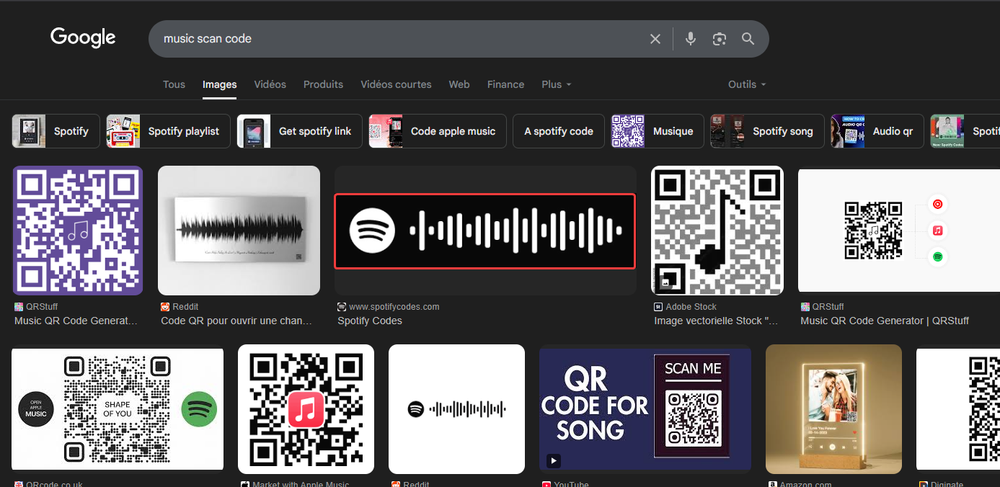
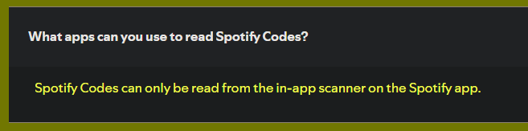
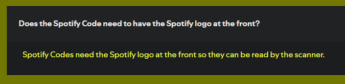
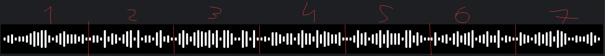
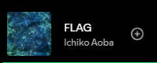
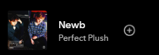
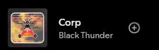
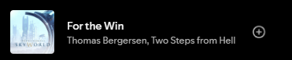
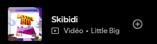

Chall2fou

La référence à la musique est assez évidente, en fouillant un peu internent avec les mots clés "code", "scan", "music" on trouve que les formes ressemblent très fortement aux codes de spotify :

(oui il fallait capter que c'étaient des codes scannables)

Une fois qu'on a cette piste, il faut se rensiegneer porécisément sur comment fonctionnent ces codes, et le [site officiel](https://www.spotifycodes.com/) aide bien pour cela :

Ce blog aide aussi : https://boonepeter.github.io/posts/2020-11-10-spotify-codes/

On comprend alors qu'un code :
- doit avoir le logo spotify à gauche
- est composé de 23 barres, dont les deux extremités sont des plus petites tailles
- doit être scanné dans l'appli spotify

Il s'agit alors de retrouver tous les codes distincts afin qu'ils puissent être scannés indépendamment : il y en a 7

Voici un script permettant de le faire, à l'aide de l'image  :

[solve.py](solve.py)

On obtient alors 7 musiques :

- Cybernight - HYPERON (musique retirée depuis, mais code fonctionne bien)
- FLAG - Ichiko Aoba 
- Is - Hel 
- Newb - Perfect Plush 
- Corp - Black Thunder 
- For the win - Thomas Bergersen, Twostep from Hell 
- Skibidi - Little Big 

Le flag est donc : ``CYBN{newb_corp_for_the_win_skibidi}``

NB : ce chall ne nécessite pas de compte Spotify premium, mais un compte Spotify tout de même, puisse-t-il être temporaire