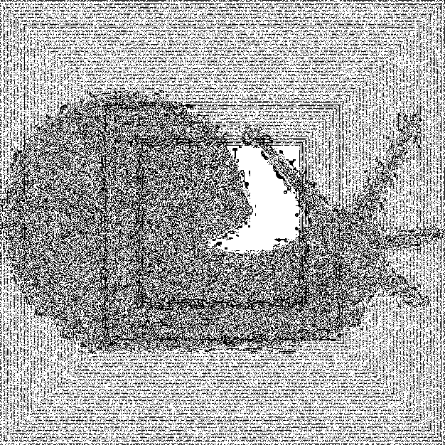
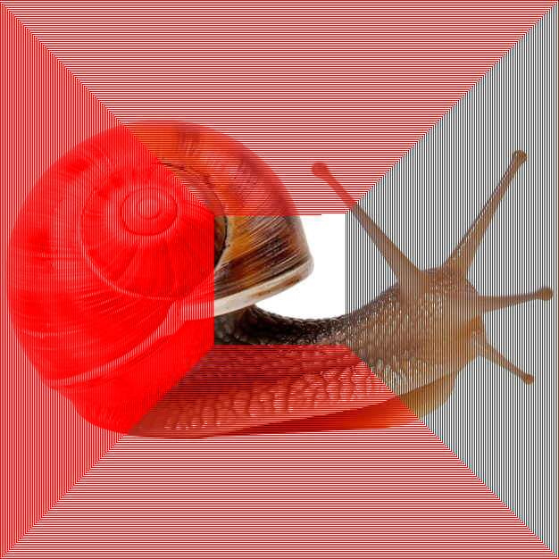
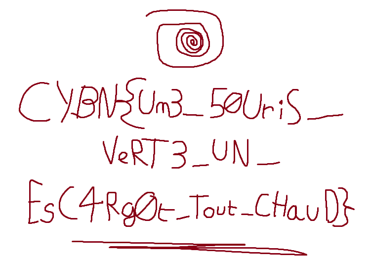

Jeez

Il s'agit de données cachées à l'aide de la méthode [LSB](https://guillaumedarkvador.wixsite.com/monsite/blank-2)

La subtilité est l'ordre d'arrangement de ces pixels cachés, que l'on peut facilement découvrir en ne regardant que le premier bit de poids faible de la couleur rouge ([aperisolve](https://aperisolve.fr/517a998b0704d6130d5e26fd1e0aba70), [stegonline](https://georgeom.net/StegOnline/image))

On peut le voir plus précisement en redésissant par-dessus l'image la forme escomptée (ouvrir l'image en grand et zoomer) :

Il faut donc réussir à lire les pixels dans l'orsdre, pour que cela forme une sorte de spirale partant du coin haut gauche, jusqu'au quasi-centre,en laissant un pixel d'écart entre chaque ligne.

C'est le taravil effectué par [../src/escargot.py](../src/escargot.py) (il sert aussi pour créer des images embedded)

Le flag obtenu est une image :

