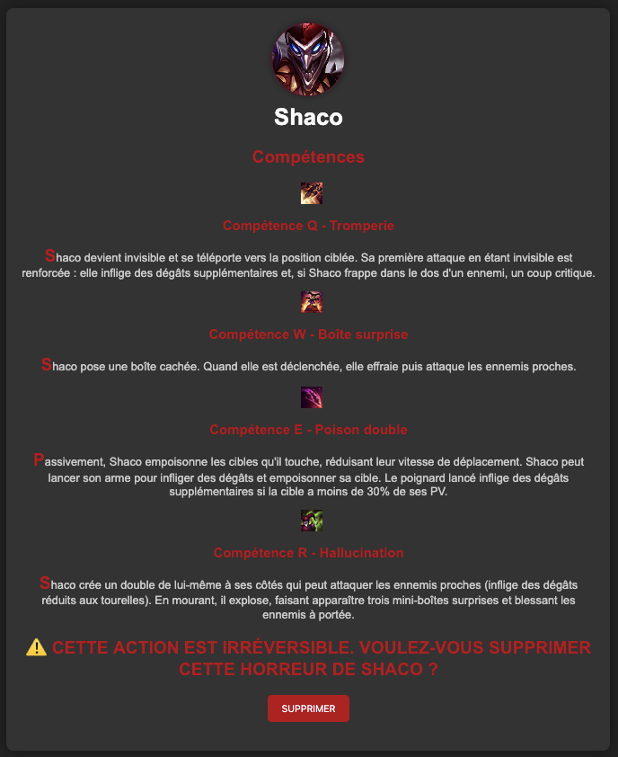

# Mon champion détesté

## Philosophie

Ce challenge avait pour intérêt principal, comme le précédent, de faire joujou avec les verbes HTTP.

On connaît les principaux, GET, POST, PATCH, PUT etc
Cela dit, le concept là était de découvrir le DELETE et les verbes custom.

## Résolution

On arrivait donc sur la page, avec un énorme bouton demandant de SUPPRIMER le champion.




Une requête post était envoyée sur une url, avec un corps json bien précis. ```{ "delete": true}```

En changeant POST par DELETE, on se retrouvait face à une erreur indiquant qu'il fallait un mot de passe.

On pouvait se retrouver bloqué à cette étape;  
Cependant, il suffisait de demander à l'URL quel type de requête était accepté avec OPTIONS.

On découvrait que le type de requête `MOT_DE_PASSE_ADMIN` était accepté. 

C'est vachement bizarre ce type de requête.

donc on request dessus, on tombe sur le mot de passe nécessaire, On renvoie une request delete avec comme corps

```json
{ 
"delete": true,
"password": "N0zzyLePlusBeau-1234"
}```

OU

```DELETE /delete-the-champ?password=N0zzyLePlusBeau-1234
...
{ "delete": true}```

Et on tombait sur le flag.

GG WP, c'était pas si dûr !

(Bon surtout à partir du moment où j'ai fix le challenge vers 4h du mat, vu qu'il ne prenait pas la réponse json... Ouais j'suis un neuille"


Crédit à Toadio pour une partie du writeup, j'ai eu la flemme de tout réécrire...
