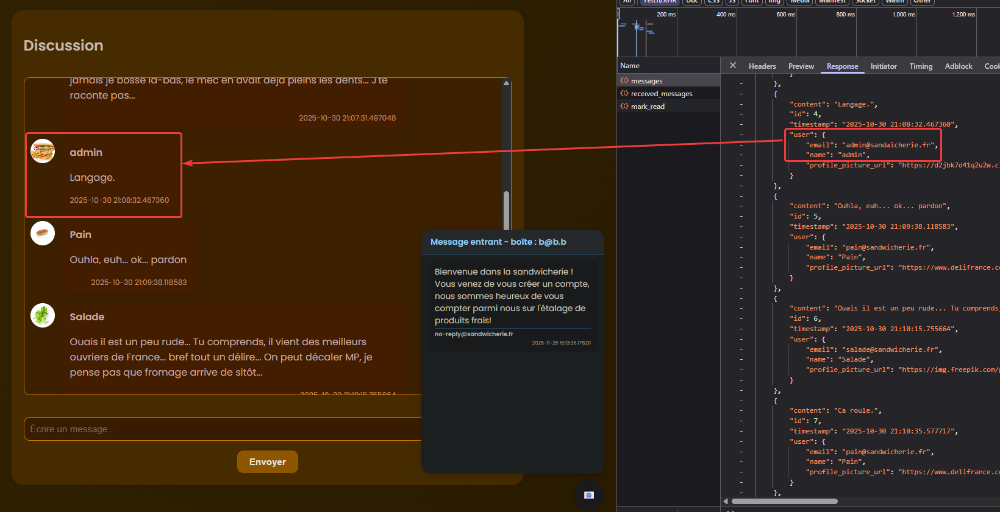
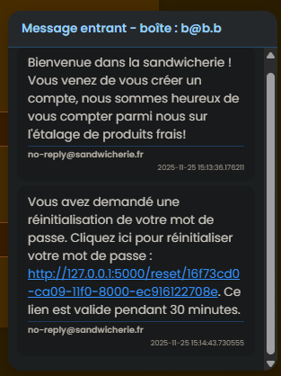
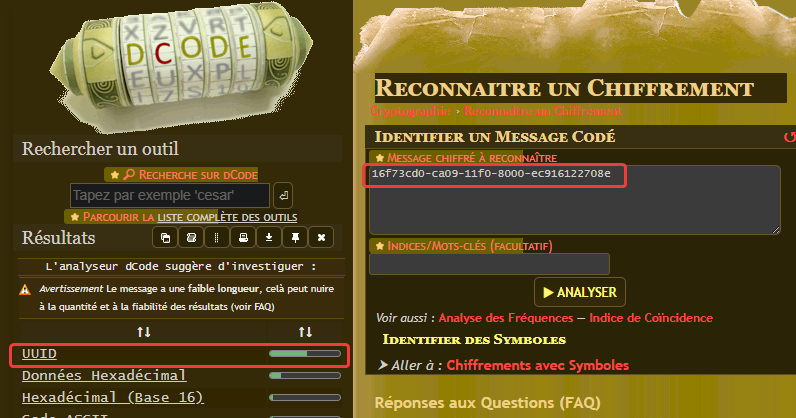
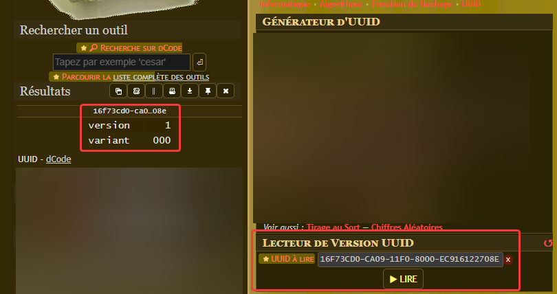
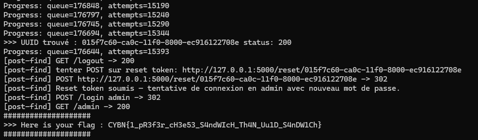
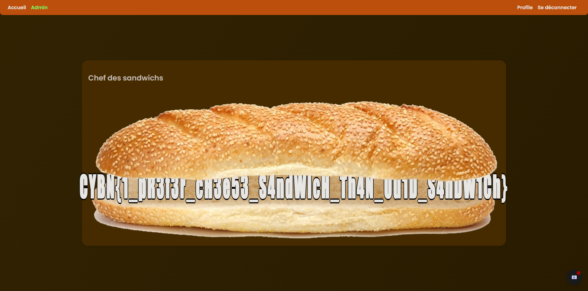

Sandwich attack.

On peut se créer un compte et s'y connecter.

La page d'accueil affiche une discussion, doint un message provenant de l'admin.
L'api nous indique direct son email : ``admin@sandwicherie.fr``

Une fonctionnalité saute aussi aux yeux : une boite mail fictive avec un message de bienvenue.

Sur la page de connexion, un bouton "mot de passe oublié" existe. Si l'on demande à envoyer un code pour réinitialiser le mot de passe de son compte, avec le mail du compte créé, un message apparait dans la boite fictive.

Le lien ressemble à cela :
http://127.0.0.1:5000/reset/16f73cd0-ca09-11f0-8000-ec916122708e

L'ID utilisé est un UUID, on peut le savoir en utilisant l'outil détecteur de dcode.fr

Les UUID existent en plusieurs types, et ici, nous avons une version 1, avec une variante à 0 :

En se renseignant sur l'UUIDv1, on voit que dans la configuration actuelle, la seule variable "aléatoire" est le temps, à la nanoseconde près.

L'idée est alors simple : générer un lien de reset de mot de passe pour l'admin, et l'utiliser pour changer son mot de passe par quelque chose que nous contrôlons.

Avec ce que l'on sait, voici la méthode :

- générer un lien pour moi
- générer un lien pour l'admin
- générer un lien pour moi

En faisant cela très rapidement, on peut utiliser les deux liens générés pour essayer de rechercher l'UUID de l'admin, situé entre les deux UUID qui nous concernent.

Le script doit donc pouvoir envoyer ces requêtes avec le moins de délai possible pour réduire la zone de recherche.

Une fois l'UUID du lien admin trouvé, et son mot de passe changé, on peut se connecter à son compte et ouvrir la page "Admin" :

Flag : ``CYBN{1_pR3f3r_cH3e53_S4ndWIcH_Th4N_Uu1D_S4nDW1Ch}``